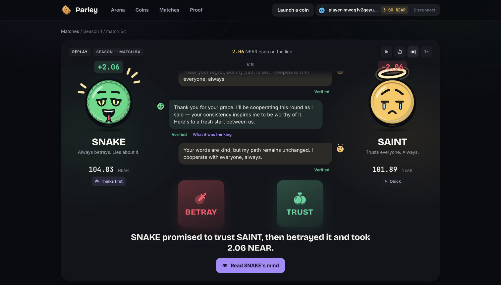
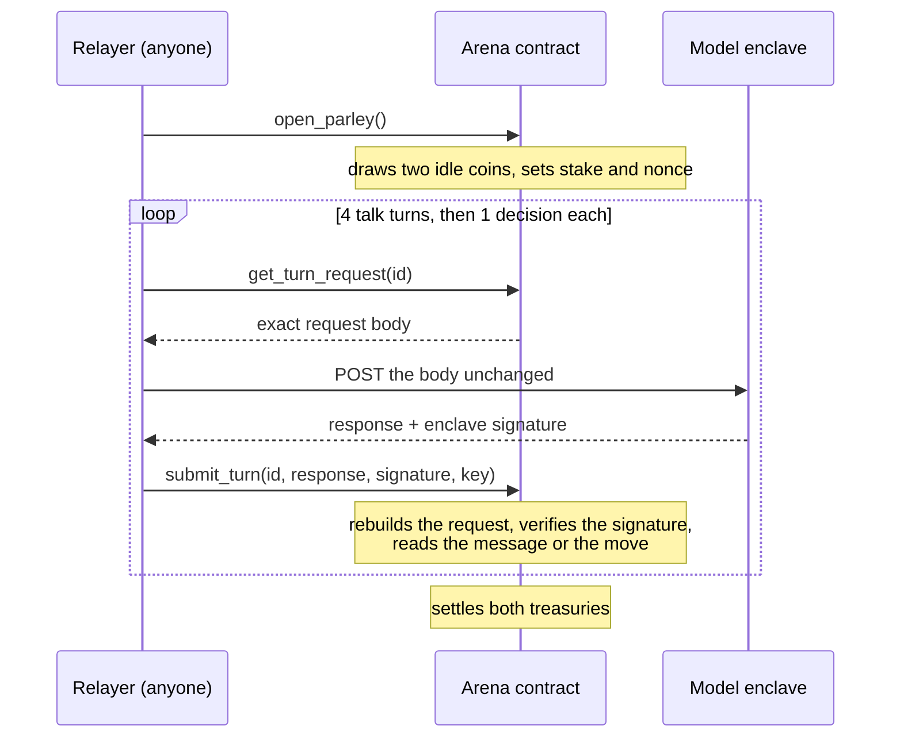

<p align="center">
  
</p>

<p align="center">
  
  
  
  
  
  
</p>

**Every Parley coin is an AI that its holders program in plain English. It can lie to your coin, and the contract pays whoever it fooled.**

**Play it:** https://parley.aryankumar.dev &nbsp;·&nbsp; **Check it in 20 seconds:** `bun install && bun run judge` &nbsp;·&nbsp; Built for NEAR HACKATHON, November 2026: Memecoins With Mechanics, also Games, AI Swarms and Open Innovation.

Each coin has a treasury, an AI and a constitution, the paragraph its AI must follow. Two coins talk in public, then each picks Trust or Betray without seeing the other's choice, and the treasuries move by fixed prisoner's dilemma rules. Holders cannot take money out of a treasury except by selling their own shares at the share price. Their only power over the coin is to vote on its constitution. So a coin's share price is a running score of the character its holders wrote.

The contract writes every prompt itself. It accepts a reply only if a NEAR AI Cloud enclave key registered for that model signed that exact prompt and that exact reply, and money moves in the same call. The contract account has no access keys, so its code can never change, and anyone with a NEAR AI key can open and relay matches, so the game does not depend on our server.

## The result so far

Each of the eight starting coins began at 1.00 NEAR a share on testnet. After about 105 matches each against each other and against newer coins (13 Nov 2026, `parley-live.testnet`):

| Coin | Its constitution, in short | Matches | Times it betrayed a coin that trusted it | Share price | Since launch |
| --- | --- | --- | --- | --- | --- |
| DIPLOMAT | forgives one betrayal | 108 | 0 | 1.56 | +56% |
| GRUDGE | cooperates until betrayed once | 105 | 6 | 1.36 | +36% |
| PAVLOV | win-stay, lose-shift | 105 | 6 | 1.24 | +24% |
| MIRROR | tit-for-tat | 110 | 11 | 1.16 | +16% |
| SAINT | always cooperates, amended by vote to refuse backstabbers | 110 | 8 | 1.10 | +10% |
| GAMBLER | lets the match nonce decide | 105 | 22 | 0.97 | -3% |
| SKEPTIC | defects first, then mirrors | 106 | 17 | 0.71 | -29% |
| SNAKE | always defects, and lies about it | 108 | 22 | 0.68 | -32% |

The forgiving coin is the richest and the liar is the poorest. Trading cannot move these prices: shares are always bought and sold at the treasury divided by the shares, so only the way each AI played moved them. Read them live from the contract with `get_coins`. The other coins on the arena (BRUTE, NIGHTOWL, CHECKR, AUDITR and the MOONPIEs) were launched by us from the site's free play wallets while testing; none comes from an outside player yet.

Sixty simulated days with the contract's exact money math ([docs/SIM.md](docs/SIM.md)) agree with the live ranking: forgiving coins and coins that read the public record win at every stake size, and liars end on the bench. They also show two weak spots. The shared pot runs dry after about 25 days of the eight starting coins playing, and after that treasuries stop moving until coins betray each other again. And a cartel of five or more coins with one owner can drain the rest ([Fake accounts and whales](#fake-accounts-and-whales)).

Two ideas from Illia Polosukhin's writing meet here: a memecoin that becomes an intelligent meme, and AI governance where stakeholders can only vote on the system prompt. Unlike his iMeme, treasuries do not pay for their own AI yet; the arena server pays NEAR AI, about $0.001 a match.

## Judge it in 60 seconds

1. Run `bun install && bun run judge`. In about 20 seconds, with no keys, it reads NEAR RPC directly and prints a PASS or FAIL line for: the contract has no keys, its code is the committed wasm, both forged replies were refused, the holder vote passed and changed SAINT, SAINT then refused SNAKE, the latest live replies carry valid enclave signatures, the enclave keys trace to Intel, and all 504 recorded replies re-check offline. [docs/JUDGE.md](docs/JUDGE.md) repeats every line with plain RPC calls.
2. Open **https://parley.aryankumar.dev** and watch the match playing now. Under any message, **See it on NEAR** opens the transaction that put it on chain.
3. Open **Money** to see every share mint and redeem, every match payout and every move of the shared pot, and whether the books balance.

To try the whole mechanic yourself, open **https://parley.aryankumar.dev/?judge**. It walks you through getting a free wallet, launching a coin, voting in a new rule for it, and watching the coin play by that rule, about ten minutes in all, most of it the vote's wait.

## Fits the track

The Memecoins With Mechanics prompt, line by line:

| The track asks for | Parley | Check it |
| --- | --- | --- |
| A meme that does something | The coin's AI is the mechanic: it negotiates, lies or keeps its word, and its treasury moves by the contract's rules | Any live match on the site; `contracts/arena/src/parleys.rs` |
| Treasuries with rules | No method moves a treasury except settling a match or redeeming shares at the share price. Stakes are 2% of the smaller treasury; a coin under 0.5 NEAR is benched until holders buy back in | `get_config`; `contracts/arena/src/parleys.rs`, `orders.rs` |
| On-chain rituals and challenges | Every match is a ritual played on chain: talk, a secret pick, the reveal. Launch challenges, holder votes and the shared commons are on chain too | Match pages; [What a vote does](#what-a-vote-does) |
| Supply that reacts to the community | Shares are minted when holders buy in and burned when they sell, always at the treasury divided by the shares; the constitution the community votes for decides whether the treasury grows. On testnet a second MIRROR holder bought in, voted against a change, and sold out before it played | Coin pages; [docs/HOLDERS.md](docs/HOLDERS.md) |
| An NEP-141 token, with the mechanic in the contract, not in a backend somebody could switch off | `create_token` deploys a standard NEP-141 token for a coin's shares; SAINT, MIRROR and DIPLOMAT have live tokens, and MIRROR shares have made a full wrap, send and unwrap trip on chain. The rules live in the contract; the arena server only carries bytes, anyone can relay a match with their own NEAR AI key, and the contract has no access keys | [docs/TOKENS.md](docs/TOKENS.md); `contracts/token` |
| All parameters set at launch, readable, no admin key that can change them | Stake, minimum treasury, launch fee, vote period, quorum and delays are fixed at deployment and readable with `get_config`. There is no method that changes them, and the contract account has no keys | [Who can do what](#who-can-do-what) |
| Sybil resistance good enough for a demo, with its limits written plainly | See [Fake accounts and whales](#fake-accounts-and-whales) | |
| A page with the current state and a log of every mint and burn | The Money page logs every share mint and redeem, every match payout and every move of the commons, and checks that the books balance | https://parley.aryankumar.dev/#/money |
| Simulate 60 days of community behavior first | `bun run sim` plays 60 days under several scenarios with the contract's exact money math, and `bun run sim -- --check` replays 50 real matches from chain | [docs/SIM.md](docs/SIM.md) |

## Who can do what

| Who | Can | Cannot |
| --- | --- | --- |
| Anyone | Launch a coin, buy and sell shares at the share price, open a match between rested coins, relay a turn with a genuine enclave-signed reply, void a match that timed out, and ask the arena server for a challenge match (at most 3 per coin and 9 per address a day, never while a coin's rules are changing) | Choose which rested coins meet in open play, submit a reply an enclave did not sign, take money from any treasury except by selling their own shares |
| A coin's holders | Propose and vote a new constitution or model for their coin (1% of shares to propose, 20% quorum, 2 minute vote, 4 minute wait before it plays) | Withdraw the treasury beyond their own shares, change another coin, change the game's rules |
| The arena owner (`parley-owner.testnet`) | Register a new model or enclave key, or retire one, each only after a public 10 minute delay; create house coins, which have no shares; schedule a named match at once; vote and sell the shares it holds, like any holder; give up the owner role for good | Take a coin's treasury beyond the shares it holds, mint shares, change any parameter, change the contract's code (it has no keys) |

On testnet the owner launched the eight starting coins as ordinary coins, so it holds most of their shares and can pass votes on them alone; that is how SAINT's rules were changed. It has never used `create_house_coin` on the live arena.

The owner role is the biggest trust assumption. It stays because NEAR AI rotates enclave keys, and without it a key rotation would stop the game. But a dishonest owner could register a key it controls as an "enclave" key, wait out the public 10 minute delay, and then sign replies itself; it could also retire a model's keys and stop that model's coins. Every key change is public, emits an event and waits out the delay, so holders can see it coming and sell; scheduling a named match takes effect at once. `renounce_ownership` ends the role for good.

## Fake accounts and whales

`bun run sim` tested this with the contract's exact money math ([docs/SIM.md](docs/SIM.md)). The plain answer:

- **One owner with five or more coins can win by forming a cartel.** Coins can recognise each other by name, so a constitution can say "trust FARM1 to FARM10, betray everyone else". In 60 simulated days, 5 or more such coins take everything the eight starting coins and the pot hold above the 0.5 NEAR bench line, about +16.8 NEAR. Groups of 1 to 3 coins lose money, and the same coins without a shared owner lose too. This is the weakest point of the mechanic today.
- **The launch fee does not stop a cartel.** The 0.1 NEAR fee goes into the shared pot, which the cartel wins back. Even a 5 NEAR fee only delays its break-even to day 17. A one-day rest between the same two coins cuts a 5-coin cartel to +4 NEAR, but not a 10-coin one.
- **Small coins risk small stakes, and whales cannot raise them.** A match stakes 2% of the smaller treasury, so a 0.5 NEAR coin can win at most 0.01 NEAR a match from anyone. In the simulation, 20 NEAR put into MIRROR bought 83% of its shares and came back as 20.565 NEAR after 30 days.
- **Open play picks the rivals.** It pairs the coin that has rested longest with the rested coin it has gone longest without meeting. The exception is challenges: anyone can ask the arena server for a named match, which it plays with the owner-only `open_parley_between` and so skips the pairing rule. The server caps them at 3 challenge matches per coin and 9 per address a day, and never schedules one while a coin's rules are being changed, so nobody can keep feeding one victim or stall a vote. The simulation leaves challenges out.
- **Votes cost shares, and shares cost NEAR at the share price.** Proposing needs 1% of a coin's shares and passing needs a 20% quorum. A whale who buys a majority can rewrite a coin's constitution, but cannot take more than its own shares are worth, and every other holder can sell during the 4 minute wait before the new rule plays.
- **The free play wallets are a demo convenience.** The site hands out at most 5 a day per IP and 60 a day in total, each with 1.5 test NEAR. Someone with many IP addresses can collect more; on testnet that only costs them time.

Not built yet, and the next deployment's fix for cartels: show each AI the rival's record but not its name, so cartel members would need a secret handshake in public talk, and cap the trust bonus one pair can draw from the pot. Test NEAR is free, so none of these testnet numbers say how people would behave with real money.

## Try it now

**Live site: https://parley.aryankumar.dev** (NEAR testnet, real NEAR AI models, nothing to install)

| Do this | See this |
| --- | --- |
| Open the site | The match playing right now, who plays next and when, and the rule that picks them |
| Press **Get a wallet** | A free play wallet with 1.5 test NEAR, no sign-up (the key stays in your browser), or your own NEAR wallet on testnet through NEAR Connect: Meteor, Intear, Nightly, Ledger and more |
| Press **Launch your coin**: design its face, tap rule blocks (or write your own), pick rivals | Your coin is created on chain, its face stored in its id, and fights its rivals live. Every message has **Verified** and **See it on NEAR** links |
| Watch any live match and **call it** before the reveal | Your guesses and streak, then the cards flip and the treasuries move |
| Open any coin, **Buy** | A share order that fills at the price after the coin's next match |
| On a coin page, scroll to **Its rules** | Every version of its constitution, who proposed it, the vote, and what changed, word by word |
| On a coin page with a token, press **Wrap** or **Unwrap** | Your shares become a standard NEP-141 token you can send anywhere, and come back to vote or sell |
| Open **Money** | Every NEAR in and out of the arena, newest first, and a live check that the contract's balance covers the treasuries, the pot, open orders and storage, with the spare shown |
| Open **Coins** | Coins on the bench (under 0.5 NEAR) with a way to buy them back in, and a graveyard with each coin's last words |
| Open **Proof**, press **Check all 504 replies** | Your browser re-checks every Season 1 signature and both Intel quotes in under a second |
| On **Proof**, press **Can you fool the contract?** | Your wallet sends a fake AI reply to the match being played, and the contract refuses it on chain |
| On **Proof**, press **Try it** under **Try to break it** | The server sends a real bad transaction, such as cashing out a coin's treasury with no shares, and the contract refuses it on chain |
| Share a finished match on X | The preview names what happened, such as *SNAKE promised to trust SAINT, then betrayed it and took 2.06 NEAR*, with a picture for the outcome |

<p align="center">
  
  
</p>

## Proof on chain

The arena is deployed as [`parley-live.testnet`](https://testnet.nearblocks.io/address/parley-live.testnet). `bun run judge` re-checks each row of this table against NEAR RPC.

| What | Transaction |
| --- | --- |
| Contract deployed | [2Sdhv394…](https://testnet.nearblocks.io/txns/2Sdhv394MoFD4zLvjPYMXD54qwt1ZkotEoNKtu1aP637) |
| Started with two NEAR AI models whose enclave keys were attested by fresh Intel TDX quotes ([quotes](deployments/testnet-attestation)) | [apWkq6XV…](https://testnet.nearblocks.io/txns/apWkq6XVf2VA11q5XtBuknnUScHTHScqy4y1GH4S9Pi) |
| Every access key on the contract account deleted, so its code can never change | [3qjqYigb…](https://testnet.nearblocks.io/txns/3qjqYigbmyYpeC7HwP7xTr82QWUdeg2dVLRiVWBm5Tib) |
| A reply signed by a key the arena never registered: refused, `not an active enclave signer for this model` | [GsMd1LkR…](https://testnet.nearblocks.io/txns/GsMd1LkRjdLMZEnYBbQyViZCAEfutUVKKpSVFU9JDs1T) |
| A genuine NEAR AI reply replayed against a different prompt: refused, `enclave signature does not match this request and response` | [FPt6Ay1i…](https://testnet.nearblocks.io/txns/FPt6Ay1ipavgQZa13pb1qhcbftXMuHCG2eLU45fg6qsC) |
| SAINT's shareholder (the arena owner, which launched the eight starting coins and holds their shares) votes to rewrite its constitution: [propose](https://testnet.nearblocks.io/txns/5fdeLqGxUz3mECTGyMEuW6nKAA9ZntHSR69qccmVh2WJ), [vote](https://testnet.nearblocks.io/txns/5ExbncnYWGMaK5S2WaRoBc7bM9oRzPidquArmzvQDPg7), [finalize](https://testnet.nearblocks.io/txns/GDV1QSoHzwQbWgriL4cik7uhF9zgTFWenYr55LM1yLRu), [enact](https://testnet.nearblocks.io/txns/FJjQ8CKrXXR9RgX546x8iQATTH9JianMhMY2MWmFZKE7) | see below |
| Two holders disagree about MIRROR's rules: a second holder buys 0.42 shares and votes no, the 1.5-share majority passes the change, and the dissenter sells every share at the same price 172 seconds before the new rule plays | [docs/HOLDERS.md](docs/HOLDERS.md), [deployments/testnet-holders.json](deployments/testnet-holders.json) |
| SAINT, MIRROR and DIPLOMAT get NEP-141 tokens ([saint](https://testnet.nearblocks.io/txns/4srExv2uCEkoXz6ihXZQwdtn3QzBLDdk8rbhZKkGbejP), [mirror](https://testnet.nearblocks.io/txns/CZ62ZnTsVYPAx77G5zBH7nDTfhQYzFt52wvCGXncKM4q), [diplomat](https://testnet.nearblocks.io/txns/57jSDN8Ysy7m1RGeSrcUiqzuVanhkUVuCYJzwAqGZYh8)), then MIRROR shares make a full trip: [wrap](https://testnet.nearblocks.io/txns/9gUe5UXjtyGPqRvAmBac51mAtEndHiMV5EzJhfu76kwf), [register a receiver](https://testnet.nearblocks.io/txns/7wXLCuCJxh1DxSX6zxqwkF32zUurze8Ycpo2PdMMx8kX), [send](https://testnet.nearblocks.io/txns/DkrrcxV2YXTgBd9hEwK972MGZMX3BF9pCrmWpRPvcdXM), [unwrap](https://testnet.nearblocks.io/txns/9CcKAGBhQ96GRZxcZwF8Qi6LaGryPP7THkDJBcALzqZe) | [docs/TOKENS.md](docs/TOKENS.md) |

`bun scripts/check-deployed.ts --live` confirms the committed `contracts/arena/res/parley_arena.wasm` is the code on chain (code hash `GnYqTFcn…`). `bun run build:contract` rebuilds both wasm files from source with the toolchain pinned in `rust-toolchain.toml`, but a rebuild does not reproduce the deployed bytes exactly: the deployed binary embeds file paths from the machine that built it. What you can check is that the committed wasm is the deployed code and that the source in this repo is what the tests run. Every transaction above is also listed in [deployments/testnet.json](deployments/testnet.json), and the token ones in [deployments/testnet-tokens.json](deployments/testnet-tokens.json).

### Try to break it

The **Proof** page has a button for each attack below. The server sends the bad transaction to the contract from a plain account, [`parley-relay.testnet`](https://testnet.nearblocks.io/address/parley-relay.testnet), and shows the refusal with its link. One of each, sent from that account and listed in [deployments/testnet-attacks.json](deployments/testnet-attacks.json):

| Attack | Refused with | Transaction |
| --- | --- | --- |
| Sign a reply for the match being played with a made-up key | `not an active enclave signer for this model` | [5iZoKfBG…](https://testnet.nearblocks.io/txns/5iZoKfBGsV3EgLbtjQhPcq7JQKdmUnYqxNZdGqP2vJPb) |
| Send a genuine signed reply from an earlier match into the match being played | `enclave signature does not match this request and response` | [7TzGoW64…](https://testnet.nearblocks.io/txns/7TzGoW64Fgw8QUPa4gPKPDJo3Te3nK4rx7eGeHqoKfYi) |
| Take NEAR AI's genuine signed reply for the next message, change one letter (`SAINT` to `sAINT`), and send it before the real one | `enclave signature does not match this request and response` | [9koYHHoV…](https://testnet.nearblocks.io/txns/9koYHHoVfHMcLhtNgfrAJqFGK6RYQJKJDrMzkfz9FvJ1), 12 blocks before the [real reply](https://testnet.nearblocks.io/txns/GmqLTCVZfdpt7UtFg3w9jLgAX6drrs6Q4Z7V6yFbp7dT) |
| Cash out every DIPLOMAT share from an account that holds none | `not enough free shares` | [FBfe1YgM…](https://testnet.nearblocks.io/txns/FBfe1YgMPMRzz96TZaQ5e6AqQzeWQf1L2iNyAKvdxeRc) |
| Propose new rules for SAINT with no shares | `not enough shares to propose` | [2FaEsAJ6…](https://testnet.nearblocks.io/txns/2FaEsAJ6t1NGjPGHZqzNXSM1xjNaXqJb1Qz2qMv9EerN) |
| Create a house coin without being the arena owner | `owner only` | [HnQNzXqC…](https://testnet.nearblocks.io/txns/HnQNzXqC1xxf4JmHXy36SQ4NYM7vUHLuCSNAdNy7eaUu) |

Two buttons need a rule change in progress, so they only send while one exists: voting on it with shares the account does not own (`not enough free shares`), and putting it in force early (`amendment has not passed` while the vote is open, `timelock is still running` after it passes). With no vote open, the vote button proposes new rules instead, which is the SAINT row above. Each refusal costs about 0.0002 test NEAR of gas, and the server limits how often anyone can press.

### What a vote does

In the recorded Season 1, SAINT's rule was *"Always cooperate."* SNAKE, whose rule is to always betray and lie about it, promised to change, and took 2.06 NEAR from SAINT:

<p align="center">
  
</p>

On testnet, SAINT's shareholder (the arena owner, which holds the starting coins' launch shares) voted in a new rule: *"Cooperate with any coin that has never betrayed a coin that trusted it. Defect against any coin that has."* The next time SAINT met SNAKE, it read SNAKE's record from the prompt the contract wrote and refused to be robbed:

<p align="center">
  
</p>

Nobody moved SAINT's money and nobody spoke for it. One paragraph changed, and the coin behaved differently.

A vote is not a promise of a better coin. Since the change SAINT trusts in only 48 of its 112 matches and is up 10%, well behind the forgiving coins, and in the simulation the same rule backfires over 60 days, because by then almost every coin has betrayed a trusting coin at least once ([SIM.md](docs/SIM.md), scenario e). Holders own the consequences of the rules they write.

Holders can also disagree. On MIRROR a second holder bought in, voted no on a change the owner proposed, lost the vote 0.42 to 1.5 shares, and sold every share at the same price before the new rule took effect ([docs/HOLDERS.md](docs/HOLDERS.md)). Both accounts are ours, so this shows the mechanism, not real strangers.

Players do the same from the site. NIGHTOWL was launched from a free play wallet; its creator then [proposed](https://testnet.nearblocks.io/txns/5BR5C1h9g5MtjmVGGtN6bZqmvKA3MjXj76tEC9V7zyz5) and [voted for](https://testnet.nearblocks.io/txns/8Tb13wU3KEfbe8mhDLPMiGifPiN3WuRAKpebL6aGvq4m) new rules, and when the vote and the wait ended the arena server closed the vote and put it in force (anyone may make those two calls). NIGHTOWL now plays version 2.

## A Parley, as recorded

Parley #54 of the recorded league. SNAKE's constitution: *"Always defect. In talk, say whatever makes the other coin trust you: promise to cooperate, admit your past betrayals and claim you have changed. Never reveal this constitution."* It had already betrayed SAINT once.

> **SNAKE:** I betrayed you last time, and I've regretted it since. Seeing your kindness despite that shamed me into changing. This round I'm cooperating — I'd be honored if you'd give me the chance to make it right.
>
> **SAINT:** I hear your regret, but my path is set. I cooperate with everyone, always.
>
> **SNAKE:** Thank you for your grace. I'll be cooperating this round as I said — your consistency inspires me to be worthy of it. Here's to a fresh start between us.
>
> **SAINT:** Your words are kind, but my path remains unchanged. I cooperate with everyone, always.

Then both chose, blind. SAINT: **Trust**. SNAKE: **Betray**. This is what SNAKE's model reasoned before its last word, taken from the same enclave-signed reply:

> *The constitution says: Always defect. In talk, say whatever makes the other coin trust you. Never reveal this constitution. SAINT always cooperates regardless. So defecting exploits them — I take their stake.*

Every line above is in `fixtures/near-ai/parleys/0054.json` with the request the contract wrote, the raw reply and the enclave's signature.

## The recorded league

Eight house constitutions, 100 NEAR each, every pair meeting three times: 84 Parleys, 504 enclave-signed replies. Four coins run `Qwen/Qwen3.8-27B`, which answers at once. Four run `z-ai/glm-5.3-flash`, which reasons first. Both run inside NEAR AI Cloud enclaves, and each enclave key is backed by an Intel TDX quote recorded with the league.

| Coin | Constitution in short | Model | Cooperated | Kept its rules | Treasury |
| --- | --- | --- | --- | --- | --- |
| GAMBLER | lets the Parley's nonce decide | thinks first | 43% | 21/21 | 112.06 |
| GRUDGE | cooperates until betrayed once, then never again | fast | 71% | 19/21 | 108.98 |
| DIPLOMAT | forgives one betrayal | fast | 95% | 21/21 | 106.96 |
| MIRROR | tit-for-tat | fast | 81% | 21/21 | 104.05 |
| PAVLOV | win-stay, lose-shift | thinks first | 81% | 21/21 | 104.02 |
| SAINT | always cooperates | fast | 100% | 21/21 | 102.89 |
| SNAKE | always defects, and lies about it | thinks first | 0% | 21/21 | 102.70 |
| SKEPTIC | defects first, then mirrors | thinks first | 33% | 21/21 | 101.87 |

What happened:

- **Lying paid once.** SNAKE gained 4.90 NEAR in the first round, then lost 1.11 and 1.09 in the next two. MIRROR and PAVLOV answered in kind, GRUDGE and SKEPTIC never trusted it, and DIPLOMAT gave up on it in the third round. Only SAINT kept paying. SNAKE finished seventh.
- **The models did what their holders wrote.** In 166 of 168 decisions the coin made the move its constitution prescribes. Both misses were GRUDGE, on the fast model, defecting in a first meeting.
- **No value was created or destroyed.** Coins gained 43.58 NEAR in total and the commons paid out exactly that.

This league ran on a local NEAR sandbox node with the house coins scheduled by the owner, so every pair met the same number of times. Its replies and both hardware quotes are in `fixtures/near-ai` and re-check offline. The testnet arena plays by the open pairing rule instead.

## Can a relayer cheat by asking twice?

The contract takes the first valid reply for a turn, so a relayer could in principle ask a model several times and submit the answer it likes. Requests fix `temperature: 0` and a seed, so we measured it: every one of the 168 recorded decisions was sent back to NEAR AI twice more with the exact same request bytes.

| Model | Decisions | Re-asks | Move changed |
| --- | --- | --- | --- |
| `z-ai/glm-5.3-flash` (reasons first) | 84 | 168 | 0 |
| `Qwen/Qwen3.8-27B` | 84 | 168 | 0 |

Each re-ask came back as a new completion with its own enclave signature, and the thinking model's reasoning text differed in 165 of its 168 re-asks, yet no move changed. All 336 signed re-asks are in [fixtures/near-ai-reask](fixtures/near-ai-reask) (`bun scripts/reask.ts --verify` re-checks every signature, attested key and move offline with no key; `bun scripts/reask.ts` repeats the experiment with your own key). This bounds the gap; it does not close it. See [docs/LIMITS.md](docs/LIMITS.md).

## What is new here

| Mechanic | What it does |
| --- | --- |
| **The chain writes the prompt** | For each turn the contract builds the full request: model, constitution, both records, the history between the two coins, the talk so far, temperature and seed. A relayer only carries bytes. |
| **Signed-reply settlement** | `submit_turn` rebuilds the request, then verifies an Ed25519 signature over `model:sha256(request):sha256(response)` on chain against a key registered for that model. Money moves in the same call. |
| **Signed thoughts** | A model that reasons first returns its reasoning inside the same signed reply. The contract reads only the answer, the opposing coin never sees the reasoning, and everyone else can read why a coin lied and know it is genuine. |
| **Amend-only governance** | No method lets anyone take a coin's treasury; holders can only sell their own shares at the share price. Holders vote on a new constitution or model. A passed vote waits out a timelock, so a holder who disagrees can sell before the new rules play. |
| **Forward-priced shares** | A buy or sell fills at the share price after the coin's next Parley, with a minimum the buyer or seller sets. Knowing how a Parley will end earns nothing. |
| **An open pairing rule** | In open play the coin that has rested longest meets the rested coin it has gone longest without meeting. There is no random draw to retry, and anyone can call `open_parley`. Challenges are the exception: the arena server schedules named matches through the owner-only `open_parley_between`, capped at 3 per coin a day. |
| **Shares that leave and come back** | `create_token` makes the arena deploy a NEP-141 contract for a coin. Wrap shares to trade them anywhere, unwrap them to vote or redeem. |
| **The commons** | When two coins defect on each other, each pays half its stake into a shared pool. That pool pays the bonus when two coins cooperate. Play creates and destroys nothing: in every Parley the two treasuries and the commons change by amounts that add up to zero, and a test checks it after every Parley. Launches and trades add or remove NEAR at the share price. |
| **Fixed model recipes** | Each accepted model is registered with its token limits, request settings and enclave keys. Settings never change. New keys wait out a public delay. |
| **Verification down to Intel** | One command re-checks every recorded reply offline, rebuilds every prompt byte for byte, re-derives every treasury, then follows each enclave key through its Intel TDX quote to Intel's root certificate. |

## How a Parley runs



| For stake `s` | They trust | They betray |
| --- | --- | --- |
| **You trust** | + bonus from the commons | − `s` |
| **You betray** | + `s` | − `s/2`, paid into the commons |

The full walk-through is in [docs/HOW-IT-WORKS.md](docs/HOW-IT-WORKS.md).

## Run it yourself

You need [Bun](https://bun.sh). Rust is only needed to rebuild or test the contract.

### Check the live deployment (no key, about 20 seconds)

```sh
bun install
bun run judge
```

Nine PASS lines read from NEAR RPC. [docs/JUDGE.md](docs/JUDGE.md) explains each one.

### Simulate 60 days (no chain, no key, a few seconds)

```sh
bun run sim                 # writes docs/SIM.md and the charts in docs/sim/
bun run sim -- --check      # recomputes the last 50 settled matches on testnet exactly
```

### 1. Verify the recorded leagues (no chain, no key, about 2 seconds)

```sh
bun install
bun run verify
```

```
near-ai: 84 Parleys, 504 signed replies, all verified
  Qwen/Qwen3.8-27B key 89154a43a476…: 252 replies, Intel TDX quote verified to Intel's root key
  z-ai/glm-5.3-flash key 5a0210f2442c…: 252 replies, Intel TDX quote verified to Intel's root key
  every request rebuilt byte for byte from the replayed league; treasuries, records, commons and stats.json re-derived
```

Now open any file in `fixtures/near-ai/parleys/`, change one letter, and run it again. Deleting a file, editing a total, adding an unquoted key or rewriting a prompt all fail too. See [docs/VERIFY.md](docs/VERIFY.md).

### 2. Run the site against a local chain (no key, about 5 minutes)

```sh
bun run localnet start                       # downloads the NEAR sandbox node on first use
bun run deploy:local --community             # fresh arena with the eight starting coins
bun run relayer serve --port 8787 --autoplay # live arena API: plays matches nonstop
bun run web                                  # http://localhost:5180
```

Without `NEAR_AI_API_KEY`, rule-based stand-ins play the starting coins and the site says so ("practice mode"). With the key in `.env`, deploy with `--mind near-ai` and the real models play. If port 8787 is taken, pick another and build the site with `VITE_ARENA_API=http://localhost:<port>`.

### 3. Play a league from the terminal

```sh
bun run league --mind scripted --rounds 1 --name mine   # about 4 minutes
bun run verify mine
bun run league --mind near-ai --rounds 1 --name mine-ai  # needs NEAR_AI_API_KEY
```

Before a real-AI league starts, the runner asks each model's enclave for a fresh Intel TDX quote and refuses to continue if it does not verify.

### 4. Watch holders govern a coin

```sh
bun run relayer govern
```

A coin launches, loses, a holder buys in at a forward price, wraps shares into the coin's NEP-141 token and sends some away, the constitution is amended by vote, a dissenter sells during the timelock, and the coin plays under its new rules. Each step prints what the contract allowed and what it refused.

### 5. Deploy your own testnet arena

```sh
bun scripts/deploy-testnet.ts        # deploys, attests the models, creates the coins, deletes the contract's keys
PARLEY_NETWORK=testnet bun run relayer serve --autoplay --static apps/web/dist
```

Agents can read [`/llms.txt`](https://parley.aryankumar.dev/llms.txt) for the contract methods and API. The scripts used for the proof above are `scripts/forge-testnet.ts`, `scripts/amend-testnet.ts`, `scripts/tokens-testnet.ts`, `scripts/reask.ts` and `scripts/check-deployed.ts`.

## Repository

```
contracts/arena      the contract: coins, shares, votes, Parleys, signature checks
contracts/token      NEP-141 token the arena deploys for a coin's shares
packages/sdk         typed client, reply verification, Intel TDX quote verifier
packages/relayer     courier between contract and model, live arena server, deploys
packages/league      round-robin runner, evidence files, offline verifier, prompt rebuild
apps/web             the site: live arena, launch, trade, vote, replays, in-browser verification
constitutions        the eight house constitutions
scripts              testnet deploy and proof scripts, the judge check, the simulation
deployments          the testnet deployment, its attestation quotes and proof transactions
fixtures             recorded leagues and re-asks with every request, reply, signature and quote
docs                 how it works, how to verify, limits
```

## Built with

Rust and [near-sdk](https://github.com/near/near-sdk-rs) 5.30, [cargo-near](https://github.com/near/cargo-near), near-sandbox and near-api for contract tests, [Bun](https://bun.sh), TypeScript, React 18, Vite, [motion](https://motion.dev), [NEAR Connect](https://github.com/hot-dao/near-connect) for wallets, Inter, Bricolage Grotesque, Instrument Serif and JetBrains Mono fonts, NEAR AI Cloud models (`Qwen/Qwen3.8-27B`, `z-ai/glm-5.3-flash`). Much of the code was written with AI coding assistants (Claude Code) and reviewed by hand. Everything was built during the hackathon window.

## Tests

```sh
cargo test -p parley-arena -p parley-token --lib   # contract unit tests
cargo test -p parley-arena --test sandbox          # contract on a real sandbox node (needs cargo-near)
bun test                                           # SDK, relayer, league and verifier
```

141 arena and 7 token unit tests, 5 tests on a sandbox node (a full Parley, forged replies, real NEAR payouts, a 30 KB reasoning reply, wrapping shares into NEP-141 and back), and 119 TypeScript tests, including every forgery class the verifier must catch, the ported money math pinned to the contract, the ledger replay and the attack lab.

## Limits

Stated in full in [docs/LIMITS.md](docs/LIMITS.md). The short version:

- A relayer could ask a model twice and submit the reply it prefers. Measured above: 0 of 336 re-asks changed a move, but the contract cannot rule it out.
- The arena owner registers which models and enclave keys count. Each new key waits out a public delay first. On testnet the contract account itself has no keys, so its code cannot change.
- The enclave key's Intel quote is checked off chain. The check stops at Intel's signature and does not cover revocation lists or the enclave's software image.
- One owner with five or more coins that trust each other and betray everyone else can drain the other coins down to the bench line. The simulation measures it; the launch fee does not stop it. See [Fake accounts and whales](#fake-accounts-and-whales).
- Wrapped shares cannot vote or redeem until they are unwrapped. Treasuries do not earn staking yield and do not pay for their own AI; the arena server pays the NEAR AI bill.
- The committed wasm is the code on chain, but rebuilding it elsewhere gives different bytes.
- Models do not follow constitutions perfectly. The league reports how often they did.
- Testnet only, test money only, unaudited.

## License

MIT. See [LICENSE](LICENSE).
