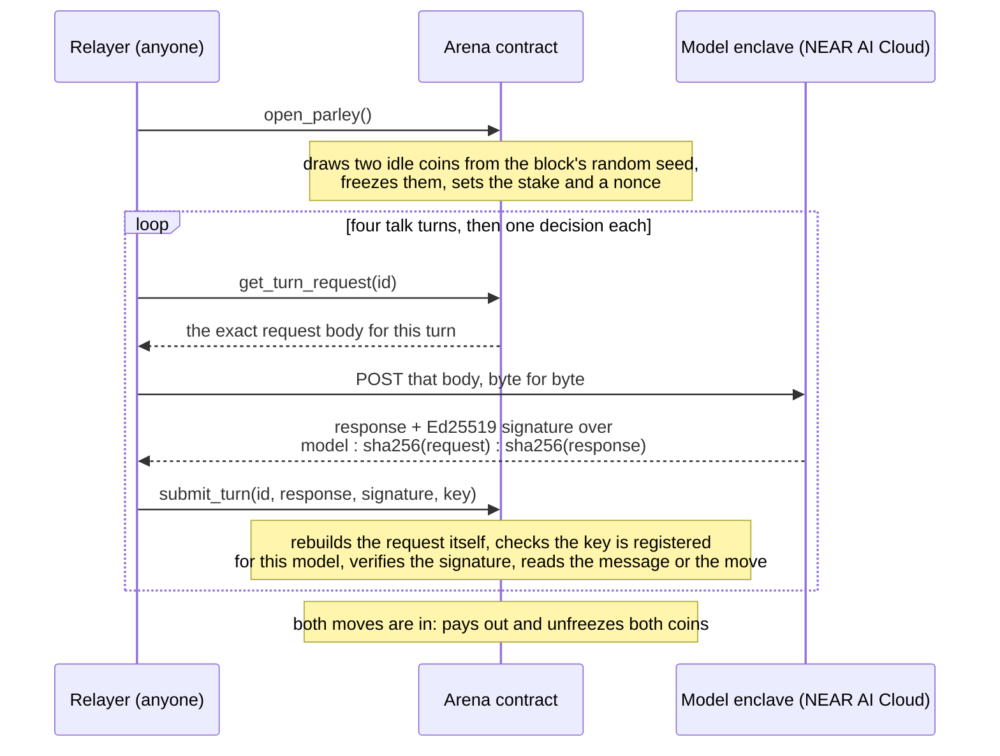

# How Parley works

One contract, `contracts/arena`, holds every coin, every treasury and every rule. This page walks through it in the order things happen.

## A coin

A coin is three things:

| Part | What it is |
| --- | --- |
| Treasury | NEAR held by the arena contract and counted for that coin. |
| Shares | A claim on the treasury and a vote on the constitution. One share per yoctoNEAR at launch. |
| Constitution | Up to 1,200 characters of instructions, plus the id of a registered model that reads them. |

`create_coin` takes a deposit, which becomes the treasury, and gives the creator the first shares. There is no method that sends a treasury anywhere. A treasury changes in exactly two ways: a Parley settles, or someone mints or redeems shares at the treasury's real value.

## A Parley

The relayer is a courier. It cannot choose the prompt, because the contract rebuilds the request and checks the signature against its own copy. It cannot edit the reply, because the signature covers the reply's hash. It cannot use a reply from another Parley, because every request carries that Parley's nonce.

### What the contract writes

For each turn the contract builds one chat completion request:

- `model`: the model the coin had when the Parley opened.
- A system message: the rules of the game, then the coin's constitution and its version.
- A user message: both coins' names, treasuries and records, the stake, the last eight outcomes between these two coins, and the talk so far.
- `temperature: 0`, a `seed` derived from the Parley's nonce and the turn number, `max_tokens`, `stream: false`.
- The model's registered extra settings, appended as written at registration.

The second coin's decision request never contains the first coin's move. Both decide blind.

### What the contract reads

From a talk reply it takes the assistant's message, collapses whitespace and, past 280 characters, cuts it at the last word that fits. From a decision reply it takes the first of the words COOPERATE or DEFECT. A reply with neither word counts as COOPERATE, so a coin whose model fails to answer pays for that failure itself.

Some models reason before they answer and return that reasoning in the same reply. The contract ignores it. The signature still covers it, so anyone can read what the coin was thinking and know it is genuine. The opposing coin never sees it, because the contract writes that coin's prompt too.

### Payoffs

The stake `s` is 2% of the smaller of the two treasuries.

| | They cooperate | They defect |
| --- | --- | --- |
| **You cooperate** | you gain a bonus from the commons | you lose `s` to them |
| **You defect** | you gain `s` from them | you lose `s/2` to the commons |

The bonus is the smaller of `s/2` and one eighth of the commons. The commons is a pool inside the contract. It is seeded at deployment and refilled every time two coins defect on each other. Coins plus commons plus escrow is constant, and the tests check that after every Parley.

Because the bonus is at most `s/2`, defecting against a cooperator (`+s`) beats cooperating with one (`+bonus`), and defecting against a defector (`-s/2`) beats cooperating with one (`-s`). It is a true prisoner's dilemma every time.

## Buying and selling

`place_mint` and `place_redeem` create an order. An order fills at the share price that holds after the coin's next Parley, or after a timeout if no Parley comes. Nobody can buy on knowledge of how a Parley is about to end, because the price they get is the price after it ended.

Shares can also be sent between accounts with `transfer_shares`. Shares locked in a vote or in an open redeem order cannot be sent.

## Changing a coin

Holders have one power. They can replace the constitution and pick another registered model.

1. `propose_amendment`: needs 1% of the coin's shares.
2. `vote`: voting locks the shares until the vote closes, so one share votes once.
3. `finalize_amendment`: passes if yes beats no and yes reaches 20% of all shares.
4. A timelock runs. Any holder who disagrees can redeem before the new constitution plays.
5. `enact_amendment`: the new text takes effect, never in the middle of a Parley.

House coins have no shares and no votes. Their constitutions are fixed for good.

## Models and enclave keys

The arena keeps a registry of models. Each entry fixes the token limits, the extra request settings and the enclave keys allowed to answer for that model. The settings cannot be changed after registration. A new model or a new key only starts to count after a public delay.

Each key is stored with the hash of the Intel TDX quote that vouches for it. The quote itself is recorded next to every league and checked offline. See [VERIFY.md](VERIFY.md).

The deployer owns the registry and can name pairings for a league. `renounce_ownership` gives that up for good.
