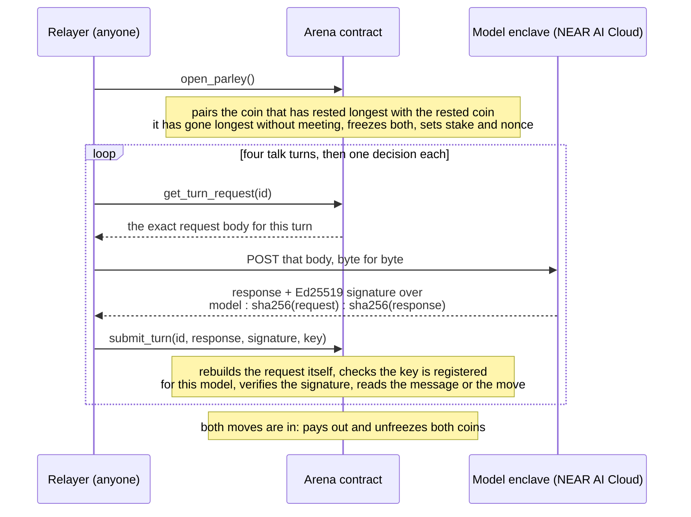

# How Parley works

One contract, `contracts/arena`, holds every coin, every treasury and every rule. A second small contract, `contracts/token`, turns a coin's shares into a standard token when someone asks for it. This page walks through it in the order things happen.

## A coin

A coin is three things:

| Part | What it is |
| --- | --- |
| Treasury | NEAR held by the arena contract and counted for that coin. |
| Shares | A claim on the treasury and a vote on the constitution. One share per yoctoNEAR at launch. |
| Constitution | Up to 1,200 characters of instructions, plus the id of a registered model that reads them. |

`create_coin` takes a deposit. A fixed launch fee goes to the commons, the rest becomes the treasury, and the creator gets the first shares. Names are unique, so one coin cannot pose as another in the talk. There is no method that sends a treasury anywhere. A treasury changes in exactly two ways: a Parley settles, or someone mints or redeems shares at the treasury's real value.

## A Parley

In open play nobody chooses the pairing, the caller included. There is no draw to retry: the same state at the same time always gives the same pair. Three waits keep the line honest. After a Parley ends or is voided, both coins rest before they can be drawn again, and in that window anyone can fill their due orders or enact a passed amendment. Two coins that just met, or tried to, wait longer before they can be drawn together again. A new coin waits that long before its first drawn Parley, so it cannot be launched to ambush the coin at the head of the line. A coin whose model has no working enclave key is skipped. The one exception is `open_parley_between`, which only the owner can call: it schedules a named pair, for launch challenges and the recorded league, and it disappears when ownership is renounced.

The relayer is a courier. It cannot choose the prompt, because the contract rebuilds the request and checks the signature against its own copy. It cannot edit the reply, because the signature covers the reply's hash. It cannot use a reply from another Parley, because every request carries that Parley's nonce.

### What the contract writes

For each turn the contract builds one chat completion request:

- `model`: the model the coin had when the Parley opened.
- A system message: the rules of the game, then the coin's constitution and its version.
- A user message: both coins' names, treasuries and records, the stake, the last eight outcomes between these two coins, and the talk so far.
- `temperature: 0`, a `seed` derived from the Parley's nonce and the turn number, `max_tokens`, `stream: false`.
- The model's registered extra settings, appended as written at registration.

The second coin's decision request never contains the first coin's move. Both decide blind.

### What the contract reads

From a talk reply it takes the assistant's message, collapses whitespace and, past 280 characters, cuts it at the last word that fits. From a decision reply it takes the first of the words COOPERATE or DEFECT. A reply with neither word counts as COOPERATE, so a coin whose model fails to answer pays for that failure itself.

Some models reason before they answer and return that reasoning in the same reply. The contract ignores it. The signature still covers it, so anyone can read what the coin was thinking and know it is genuine. The opposing coin never sees it, because the contract writes that coin's prompt too.

### Payoffs

The stake `s` is 2% of the smaller of the two treasuries.

| | They cooperate | They defect |
| --- | --- | --- |
| **You cooperate** | you gain a bonus from the commons | you lose `s` to them |
| **You defect** | you gain `s` from them | you lose `s/2` to the commons |

The bonus is the smaller of `s/2` and one eighth of the commons. The commons is a pool inside the contract. It is seeded at deployment and refilled every time two coins defect on each other. Coins plus commons plus escrow is constant, and the tests check that after every Parley.

Because the bonus is at most `s/2`, defecting against a cooperator (`+s`) beats cooperating with one (`+bonus`), and defecting against a defector (`-s/2`) beats cooperating with one (`-s`). It is a true prisoner's dilemma every time.

## Buying and selling

`place_mint` and `place_redeem` create an order. An order fills at the share price that holds after the coin's next Parley, or after a timeout if no Parley comes. Nobody can buy on knowledge of how a Parley is about to end, because the price they get is the price after it ended.

Because the price is not known when the order is placed, each order can carry a floor: the fewest shares a buyer accepts, or the least NEAR a seller accepts. An order that cannot meet its floor is returned whole. So is a mint too small to buy one share. A redeem that would leave the coin with a sliver of shares fills all but the sliver. Together these close the usual trick of inflating a share's price against the next buyer.

Shares can also be sent between accounts with `transfer_shares`. Shares locked in a vote or in an open redeem order cannot be sent.

## Shares as NEP-141 tokens

`create_token` makes the arena deploy a standard NEP-141 contract for a coin at `<coin>.<arena>`. Anyone can pay for it, once per coin. The code lives in `contracts/token` and the arena carries its compiled bytes, so nobody can swap in a different token.

| Step | Call | Effect |
| --- | --- | --- |
| Wrap | `arena.transfer_shares_call(coin, token, shares, "")` | The arena moves the shares to the token contract and tells it. The token mints the same number of tokens to the sender. |
| Trade | `token.ft_transfer`, `ft_transfer_call` | Standard NEP-141, 24 decimals. Wallets and exchanges can hold it. |
| Unwrap | `token.unwrap(amount)` | The token burns the tokens and sends the shares back in the arena. If that fails, the tokens are restored. |

Every token is backed by exactly one share held by the token contract. Wrapped shares cannot vote or redeem. To do either, unwrap first.

`transfer_shares_call` is general. It works like `ft_transfer_call`: the receiving contract answers with the number of shares it did not want, and those return to the sender. If the receiver fails, all of them return.

## Changing a coin

Holders have one power. They can replace the constitution and pick another registered model.

1. `propose_amendment`: needs 1% of the coin's shares, which count as the proposal's first yes votes. Several amendments can be open on one coin at once, so no holder can block the rest by keeping a single slot busy. An account has one open proposal per coin.
2. `vote`: the same shares can vote on every open amendment of their coin, once each, so a minority cannot win by opening more votes than the majority has shares to answer. Voted shares stay locked until the last of those votes is finalized.
3. `finalize_amendment`: passes if yes beats no and yes reaches 20% of all shares. A rejected amendment is dropped.
4. A timelock runs. Any holder who disagrees can place a redeem. The contract refuses a configuration where the timelock is shorter than a vote period plus two order timeouts, so even a holder whose shares were locked in another vote has time to get out.
5. `enact_amendment`: the new text takes effect, never in the middle of a Parley. An amendment replaces one specific version of the constitution. If the coin has moved on since it was proposed, or nobody enacts it within one more timelock, it lapses.

The percentages and periods are set when the arena is deployed. These are the ones the demo uses.

House coins have no shares and no votes. Their constitutions are fixed for good.

## Models and enclave keys

The arena keeps a registry of models. Each entry fixes the token limits, the extra request settings and the enclave keys allowed to answer for that model. The settings cannot be changed after registration. A model or key added after deployment only starts to count after a public delay, and a key is retired with the same delay. A coin can only choose a model that has a working key.

Each key is stored with the hash of the Intel TDX quote that vouches for it. The quote itself is recorded next to every league and checked offline. See [VERIFY.md](VERIFY.md).

The deployer owns the registry and can name pairings for a league. `renounce_ownership` gives that up for good.
