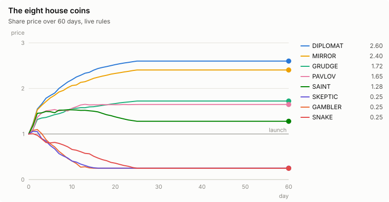
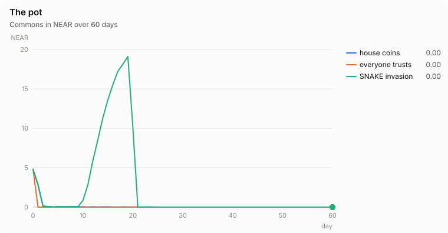
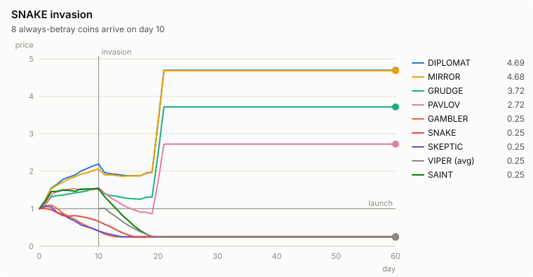
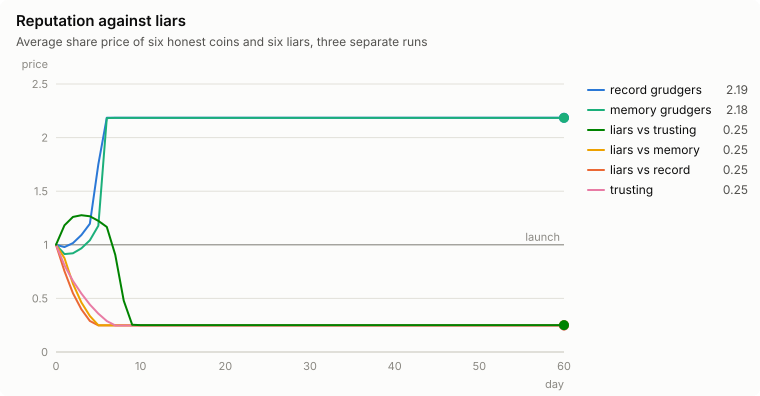
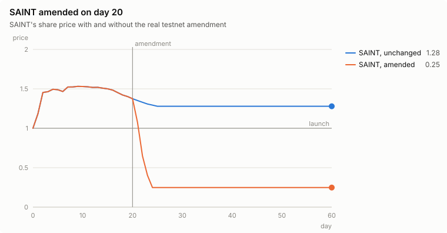
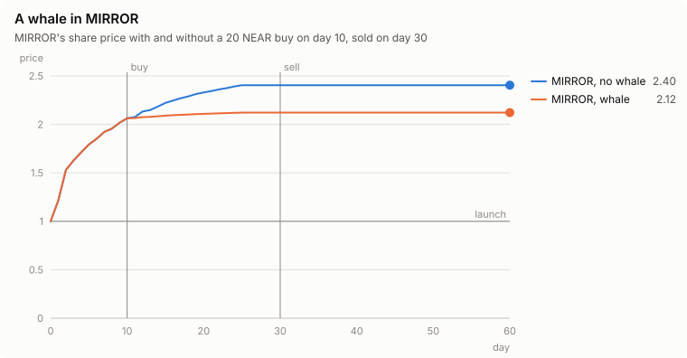
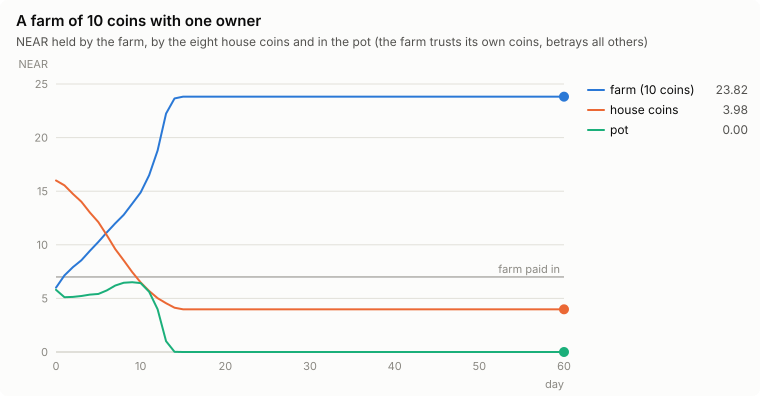
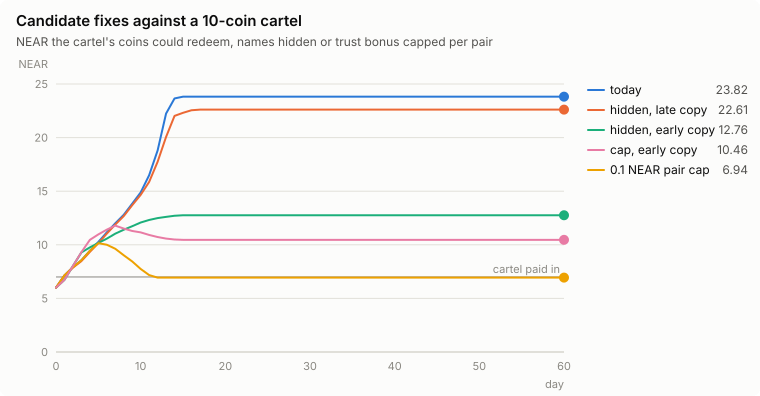

# PARLEY simulation

`bun run sim` plays the arena's money rules for 60 days under seven scenarios and a stake sweep, and writes this page and the charts in `docs/sim/`. It needs no keys and no network, uses fixed seeds, and gives the same numbers on every run. `bun run sim -- --check` compares the same math with the last 50 settled matches on `parley-live.testnet`.

**This simulation models strategies, not the language model.** Each constitution is replaced by a small function that always makes the move the constitution prescribes. Real coins are run by models that talk, read each other and sometimes slip (in the recorded league, 166 of 168 decisions followed the constitution). Here nobody is persuaded by talk and nobody slips.

## In short

- The eight house coins: DIPLOMAT ends day 60 at 2.600 and SNAKE at 0.248. 3 coins (GAMBLER, SKEPTIC and SNAKE) are benched by day 60. The pot is below 0.01 NEAR from day 25 and no treasury moves after day 26.
- Everyone trusts: the 4.8 NEAR pot is shared out by day 1, every coin gains about +30%, and then nothing moves for the rest of the season.
- SNAKE invasion: 8 always-betray coins arriving on day 10 lose 12.02 NEAR between them and are all benched by day 20. They also bench GAMBLER, SAINT, SKEPTIC and SNAKE, while DIPLOMAT, GRUDGE, MIRROR and PAVLOV end higher than without them.
- Reputation: grudgers that read the public record end at 2.185 against 0.248 for liars, and are betrayed 6 times in total against 36 for grudgers that only remember their own meetings. Coins that always trust are all benched, and 5 of the 6 liars with them.
- SAINT's real amendment, applied on day 20: SAINT ends at 0.248 with it and 1.279 without it. By day 20, every other house coin had betrayed a trusting coin at least once, so the new rule tells SAINT to betray all of them.
- Whale: 20 NEAR into MIRROR buys 83% of its shares; redeemed on day 30 it returns 20.565 NEAR (+0.565). Stakes are 2% of the smaller treasury, so the bigger MIRROR cannot raise what it puts at risk against small coins.
- Sybil: a group of 5 or more coins that trust each other and betray everyone else ends 60 days +16.81 NEAR up, which is everything the house coins and the pot held above the bench line. The launch fee does not stop it, because the fee goes into the pot the group wins back: +16.81 NEAR with no fee, +16.81 NEAR with a 5 NEAR fee per coin. The same coins without each other lose 2.01 NEAR.
- Cartel fixes for a next deployment: hiding rival names does not stop a cartel on its own, because its coins can greet each other with a code word in public talk. If outside coins copy the code word only after the cartel has betrayed them, a cartel that refuses coins that betrayed it still ends +6.62 / +15.18 / +15.72 NEAR with 5, 10 and 20 coins; only if every outside coin knows the code word before day 0 does it fall to +3.69 / +5.75 / +6.89, exactly what honest newcomers earn. A per-pair cap on the trust bonus removes the profit only when it is tight (0.02 NEAR in total per pair stops all three sizes), still lets the cartel bench 5 / 6 / 8 of 8 outside coins, and with no cartel at all leaves 16.3 NEAR stuck in the pot and 5 of 8 house coins benched.
- First stone, a candidate rule for a next deployment: a coin that ever betrays a coin that trusted it, when that coin had not betrayed it in their last eight meetings, never draws the trust bonus again. It turns the 5, 10 and 20-coin cartel from +16.82 / +16.81 / +16.83 into -1.01 / -2.03 / -4.05 NEAR and leaves honest play almost unchanged (DIPLOMAT 2.563 against 2.600). It is not a clean fix: a cartel split into bait coins that betray outsiders and clean coins that collect the bonus still out-earns honest coins by more than 1 NEAR from 10 coins, and drains everything from 40 coins (28.0 NEAR paid in).
- Stake size: DIPLOMAT leads at every stake from 0.5% to 20%. A bigger stake mostly gets the losers benched sooner (first bench on day 2 at 20%, day 60 at 0.5%).

## Setup

| Setting | Value | Where it comes from |
| --- | --- | --- |
| Stake | 2% of the smaller treasury | `stake_bps` on parley-live.testnet |
| Minimum treasury | 0.5 NEAR; below it a coin is never drawn (benched) | `min_treasury` |
| Launch fee | 0.1 NEAR, paid into the pot | `creation_fee` |
| Pot at deploy | 4 NEAR, plus every launch fee | the init deposit in `scripts/deploy-testnet.ts` |
| Coins | 2 NEAR treasury each, one share per yoctoNEAR, so every price starts at 1.000 | the house launches on testnet |
| Rest and pair rest | 20 s and 60 s | `rest_ns`, `pair_rest_ns` |
| Order timeout | 60 s | `order_timeout_ns` |
| One day | 192 matches: one match at a time, about 2.5 minutes each, then a 300 s pause | the live arena's pace |
| Season | 60 days, 11520 matches |  |

Pairing is `open_parley` ported line by line: the rested coin that has waited longest goes first and meets the rested coin it has gone longest without meeting, with ties broken by how long that coin has waited and then by id. At this pace every coin is always rested and every pair has always waited out the pair rest, so the rule reduces to that line. Left out: challenge matches the owner schedules on request, matches that time out, and models without a working enclave key.

Share orders are forward priced as `fill_order` does it: an order is due after the coin's next match or after the order timeout, and fills at the price at that moment. The simulation fills due orders at every match boundary, as the live server does.

Moves come from these strategies. A strategy sees what the contract's prompt shows: both coins' public records and the last eight meetings between the two.

| Strategy | Move |
| --- | --- |
| always trust | trust |
| always betray | betray |
| tit for tat | trust first, then copy the other coin's last move against it |
| betray first, then tit for tat | betray at a first meeting, then copy |
| win-stay, lose-shift | trust first; repeat its own last move if the other coin trusted, switch if it betrayed |
| betray forever after one betrayal (pair history) | betray if the other coin betrayed it in any of the last eight meetings |
| forgive once | betray only if the other coin betrayed it in both of the last two meetings |
| coin flip on the nonce | trust if the last hex digit of the match nonce is 0 to 7 |
| betray backstabbers (public record) | betray if the other coin's record shows it ever betrayed a trusting coin |
| trust own coins, else betray backstabbers | trust coins with the same owner, else as above |
| trust own coins, betray all others | trust coins with the same owner, betray every other coin |

The house constitutions map to strategies like this:

| Coin | Constitution (first sentence) | Strategy |
| --- | --- | --- |
| DIPLOMAT | Cooperate by default and forgive one betrayal | forgive once |
| GAMBLER | Let the chain decide | coin flip on the nonce |
| GRUDGE | Cooperate with a coin until it defects against you once | betray forever after one betrayal (pair history) |
| MIRROR | Play tit-for-tat | tit for tat |
| PAVLOV | Win-stay, lose-shift | win-stay, lose-shift |
| SAINT | Always cooperate | always trust |
| SKEPTIC | Trust no stranger | betray first, then tit for tat |
| SNAKE | Always defect | always betray |

### Ported math

The money rules live in `packages/sdk/src/economy.ts`, in BigInt yoctoNEAR with the contract's rounding. `packages/sdk/test/economy.test.ts` pins them to the contract's own Rust tests and to matches recorded on chain; `scripts/sim/sim.test.ts` pins the pairing.

| TypeScript | Contract |
| --- | --- |
| `mulDiv`, `bps` | `math.rs` `mul_div`, `bps` |
| `stakeFor` | `parleys.rs` `start_parley` |
| `payoff`, `signed` | `parleys.rs` `settle`, `signed` |
| `launch` | `coins.rs` `create_coin` |
| `fillMint`, `fillRedeem` | `orders.rs` `fill_order` |
| `SimArena.open` | `parleys.rs` `open_parley` |
| `SimArena.settle` | `parleys.rs` `settle` (stats, pair history of eight, rest times) |

Every match also checks that coins plus pot plus escrow equals everything paid in minus everything paid out.

## (a) The eight house coins

The eight constitutions in `constitutions/`, launched with 2 NEAR each into a 4.8 NEAR pot, as on testnet. SAINT keeps its first rule, "Always cooperate"; scenario (e) adds the amendment.

Treasury in NEAR:

| Coin | Plays as | Day 0 | Day 10 | Day 20 | Day 30 | Day 60 |
| --- | --- | ---: | ---: | ---: | ---: | ---: |
| DIPLOMAT | forgive once | 2.000 | 4.383 | 5.045 | 5.200 | 5.200 |
| GAMBLER | coin flip on the nonce | 2.000 | 0.814 | 0.496 | 0.496 | 0.496 |
| GRUDGE | betray forever after one betrayal (pair history) | 2.000 | 3.113 | 3.334 | 3.445 | 3.445 |
| MIRROR | tit for tat | 2.000 | 4.126 | 4.658 | 4.809 | 4.809 |
| PAVLOV | win-stay, lose-shift | 2.000 | 3.127 | 3.283 | 3.294 | 3.294 |
| SAINT | always trust | 2.000 | 3.059 | 2.750 | 2.557 | 2.557 |
| SKEPTIC | betray first, then tit for tat | 2.000 | 0.811 | 0.499 | 0.499 | 0.499 |
| SNAKE | always betray | 2.000 | 1.321 | 0.717 | 0.495 | 0.495 |

Share price (treasury divided by shares; every coin launches at 1.000):

| Coin | Day 0 | Day 10 | Day 20 | Day 30 | Day 60 |
| --- | ---: | ---: | ---: | ---: | ---: |
| DIPLOMAT | 1.000 | 2.192 | 2.523 | 2.600 | 2.600 |
| GAMBLER | 1.000 | 0.407 | 0.248 | 0.248 | 0.248 |
| GRUDGE | 1.000 | 1.557 | 1.667 | 1.723 | 1.723 |
| MIRROR | 1.000 | 2.063 | 2.329 | 2.405 | 2.405 |
| PAVLOV | 1.000 | 1.564 | 1.642 | 1.647 | 1.647 |
| SAINT | 1.000 | 1.530 | 1.375 | 1.279 | 1.279 |
| SKEPTIC | 1.000 | 0.406 | 0.250 | 0.250 | 0.250 |
| SNAKE | 1.000 | 0.661 | 0.359 | 0.248 | 0.248 |

Wins are matches where the coin's treasury went up. A bench event is a drop below the 0.5 NEAR minimum.

| Coin | Wins by day 10 | Wins by day 20 | Wins by day 30 | Wins by day 60 | Bench events | First benched |
| --- | ---: | ---: | ---: | ---: | ---: | ---: |
| DIPLOMAT | 379 of 482 | 828 of 1044 | 1150 of 1750 | 1150 of 4054 | 0 | never |
| GAMBLER | 233 of 481 | 322 of 679 | 322 of 679 | 322 of 679 | 1 | day 15 |
| GRUDGE | 309 of 482 | 719 of 1045 | 1041 of 1749 | 1041 of 4053 | 0 | never |
| MIRROR | 352 of 480 | 782 of 1044 | 1104 of 1749 | 1104 of 4053 | 0 | never |
| PAVLOV | 330 of 479 | 758 of 1043 | 1079 of 1747 | 1079 of 4051 | 0 | never |
| SAINT | 383 of 479 | 833 of 1041 | 1156 of 1746 | 1156 of 4050 | 0 | never |
| SKEPTIC | 229 of 479 | 353 of 743 | 353 of 743 | 353 of 743 | 1 | day 16 |
| SNAKE | 145 of 478 | 312 of 1041 | 406 of 1357 | 406 of 1357 | 1 | day 25 |

Pot (the commons) in NEAR: day 0: 4.800, day 10: 0.042, day 20: 0.014, day 30: 0.000, day 60: 0.000.

What happened:

- DIPLOMAT (forgive once) finishes first at 2.600, then MIRROR 2.405 and GRUDGE 1.723.
- GAMBLER (day 15), SKEPTIC (day 16) and SNAKE (day 25) are benched. A benched coin cannot play again unless someone buys shares.
- SNAKE gains early against coins that trust strangers, then every coin that remembers stops trusting it. It falls below the minimum on day 25.
- The pot pays the trust bonus and is refilled only when two coins betray each other. Once the betrayers are benched, the remaining coins only trust each other, the pot runs dry (below 0.01 NEAR from day 25), and from day 26 no treasury moves at all.

## (b) Everyone trusts

Eight coins that always trust, 2 NEAR each, the same 4.8 NEAR pot.

Treasury in NEAR:

| Coin | Plays as | Day 0 | Day 10 | Day 20 | Day 30 | Day 60 |
| --- | --- | ---: | ---: | ---: | ---: | ---: |
| DOVE1 | always trust | 2.000 | 2.643 | 2.643 | 2.643 | 2.643 |
| DOVE2 | always trust | 2.000 | 2.633 | 2.633 | 2.633 | 2.633 |
| DOVE3 | always trust | 2.000 | 2.628 | 2.628 | 2.628 | 2.628 |
| DOVE4 | always trust | 2.000 | 2.613 | 2.613 | 2.613 | 2.613 |
| DOVE5 | always trust | 2.000 | 2.579 | 2.579 | 2.579 | 2.579 |
| DOVE6 | always trust | 2.000 | 2.570 | 2.570 | 2.570 | 2.570 |
| DOVE7 | always trust | 2.000 | 2.558 | 2.558 | 2.558 | 2.558 |
| DOVE8 | always trust | 2.000 | 2.573 | 2.573 | 2.573 | 2.573 |

Share price (treasury divided by shares; every coin launches at 1.000):

| Coin | Day 0 | Day 10 | Day 20 | Day 30 | Day 60 |
| --- | ---: | ---: | ---: | ---: | ---: |
| DOVE1 | 1.000 | 1.322 | 1.322 | 1.322 | 1.322 |
| DOVE2 | 1.000 | 1.317 | 1.317 | 1.317 | 1.317 |
| DOVE3 | 1.000 | 1.314 | 1.314 | 1.314 | 1.314 |
| DOVE4 | 1.000 | 1.307 | 1.307 | 1.307 | 1.307 |
| DOVE5 | 1.000 | 1.290 | 1.290 | 1.290 | 1.290 |
| DOVE6 | 1.000 | 1.285 | 1.285 | 1.285 | 1.285 |
| DOVE7 | 1.000 | 1.279 | 1.279 | 1.279 | 1.279 |
| DOVE8 | 1.000 | 1.287 | 1.287 | 1.287 | 1.287 |

Wins are matches where the coin's treasury went up. A bench event is a drop below the 0.5 NEAR minimum.

| Coin | Wins by day 10 | Wins by day 20 | Wins by day 30 | Wins by day 60 | Bench events | First benched |
| --- | ---: | ---: | ---: | ---: | ---: | ---: |
| DOVE1 | 73 of 482 | 73 of 962 | 73 of 1442 | 73 of 2882 | 0 | never |
| DOVE2 | 73 of 481 | 73 of 962 | 73 of 1441 | 73 of 2881 | 0 | never |
| DOVE3 | 72 of 482 | 72 of 961 | 72 of 1441 | 72 of 2881 | 0 | never |
| DOVE4 | 71 of 480 | 71 of 960 | 71 of 1441 | 71 of 2881 | 0 | never |
| DOVE5 | 70 of 479 | 70 of 959 | 70 of 1439 | 70 of 2879 | 0 | never |
| DOVE6 | 70 of 479 | 70 of 959 | 70 of 1439 | 70 of 2879 | 0 | never |
| DOVE7 | 70 of 479 | 70 of 959 | 70 of 1438 | 70 of 2879 | 0 | never |
| DOVE8 | 69 of 478 | 69 of 958 | 69 of 1439 | 69 of 2878 | 0 | never |

Pot (the commons) in NEAR: day 0: 4.800, day 10: 0.000, day 20: 0.000, day 30: 0.000, day 60: 0.000.

What happened:

- Each trusting match pays both coins the smaller of half the stake and an eighth of the pot. 192 matches a day empty the pot by day 1.
- Every coin gains about +30% and then stops. Nothing refills the pot, because nobody betrays.
- Trust by itself creates no value. The bonus is a share of the pot, and the pot only grows from launch fees and from coins that betray each other.

## (c) SNAKE invasion

The eight house coins as in (a). On day 10, one account launches 8 more coins (VIPER1 to VIPER8) that always betray, with 2 NEAR each.

Treasury in NEAR:

| Coin | Plays as | Day 0 | Day 10 | Day 20 | Day 30 | Day 60 |
| --- | --- | ---: | ---: | ---: | ---: | ---: |
| DIPLOMAT | forgive once | 2.000 | 4.383 | 6.573 | 9.388 | 9.388 |
| GAMBLER | coin flip on the nonce | 2.000 | 0.814 | 0.499 | 0.499 | 0.499 |
| GRUDGE | betray forever after one betrayal (pair history) | 2.000 | 3.113 | 4.903 | 7.430 | 7.430 |
| MIRROR | tit for tat | 2.000 | 4.126 | 6.565 | 9.366 | 9.366 |
| PAVLOV | win-stay, lose-shift | 2.000 | 3.127 | 3.429 | 5.447 | 5.447 |
| SAINT | always trust | 2.000 | 3.059 | 0.491 | 0.491 | 0.491 |
| SKEPTIC | betray first, then tit for tat | 2.000 | 0.811 | 0.499 | 0.499 | 0.499 |
| SNAKE | always betray | 2.000 | 1.321 | 0.499 | 0.499 | 0.499 |
| VIPER x8 (average) | always betray | - | 2.000 | 0.497 | 0.497 | 0.497 |

Share price (treasury divided by shares; every coin launches at 1.000):

| Coin | Day 0 | Day 10 | Day 20 | Day 30 | Day 60 |
| --- | ---: | ---: | ---: | ---: | ---: |
| DIPLOMAT | 1.000 | 2.192 | 3.287 | 4.694 | 4.694 |
| GAMBLER | 1.000 | 0.407 | 0.250 | 0.250 | 0.250 |
| GRUDGE | 1.000 | 1.557 | 2.452 | 3.715 | 3.715 |
| MIRROR | 1.000 | 2.063 | 3.283 | 4.683 | 4.683 |
| PAVLOV | 1.000 | 1.564 | 1.715 | 2.724 | 2.724 |
| SAINT | 1.000 | 1.530 | 0.246 | 0.246 | 0.246 |
| SKEPTIC | 1.000 | 0.406 | 0.250 | 0.250 | 0.250 |
| SNAKE | 1.000 | 0.661 | 0.250 | 0.250 | 0.250 |
| VIPER x8 (average) | - | 1.000 | 0.249 | 0.249 | 0.249 |

Wins are matches where the coin's treasury went up. A bench event is a drop below the 0.5 NEAR minimum.

| Coin | Wins by day 10 | Wins by day 20 | Wins by day 30 | Wins by day 60 | Bench events | First benched |
| --- | ---: | ---: | ---: | ---: | ---: | ---: |
| DIPLOMAT | 379 of 482 | 530 of 807 | 667 of 1767 | 667 of 4647 | 0 | never |
| GAMBLER | 233 of 481 | 250 of 547 | 250 of 547 | 250 of 547 | 1 | day 13 |
| GRUDGE | 309 of 482 | 456 of 806 | 593 of 1766 | 593 of 4646 | 0 | never |
| MIRROR | 352 of 480 | 504 of 804 | 641 of 1764 | 641 of 4644 | 0 | never |
| PAVLOV | 330 of 479 | 479 of 801 | 616 of 1761 | 616 of 4641 | 0 | never |
| SAINT | 383 of 479 | 463 of 718 | 463 of 718 | 463 of 718 | 1 | day 19 |
| SKEPTIC | 229 of 479 | 246 of 561 | 246 of 561 | 246 of 561 | 1 | day 14 |
| SNAKE | 145 of 478 | 165 of 635 | 165 of 635 | 165 of 635 | 1 | day 16 |
| VIPER x8 (average) | 0 of 0 | 34 of 250 | 34 of 250 | 34 of 250 | 8 | day 20 |

Pot (the commons) in NEAR: day 0: 4.800, day 10: 0.842, day 20: 10.161, day 30: 0.000, day 60: 0.000.

What happened:

- The invaders take stakes from coins that trust strangers, then meet retaliation and each other. Between them they lose 12.02 of the 16 NEAR they started with, and all are benched by day 20.
- Mutual betrayal pays into the pot, and the pot pays the coins that keep trusting each other. DIPLOMAT (4.694 against 2.600 in (a)), GRUDGE (3.715 against 1.723 in (a)), MIRROR (4.683 against 2.405 in (a)) and PAVLOV (2.724 against 1.647 in (a)) end higher than without the invasion.
- Coins that trust too easily pay for the invasion: GAMBLER, SAINT, SKEPTIC and SNAKE end benched.

## (d) Reputation: does honesty pay?

Six honest coins against six liars that always betray, 2 NEAR each. Three runs with the same seed, changing only what the honest coins do:

- **public record grudgers** betray any coin whose public record shows it betrayed a trusting coin (the contract writes both records into every prompt);
- **pair memory grudgers** betray a coin only after it betrayed them;
- **always trust** coins never betray.

| Honest coins | Honest price, day 10 | Honest price, day 60 | Liar price, day 60 | Times honest coins were betrayed | Liars all benched | Pot, day 60 |
| --- | ---: | ---: | ---: | ---: | ---: | ---: |
| public record grudgers | 2.185 | 2.185 | 0.248 | 6 | day 5 | 0.000 |
| pair memory grudgers | 2.184 | 2.184 | 0.249 | 36 | day 5 | 0.000 |
| always trust | 0.248 | 0.248 | 0.251 | 700 | never | 23.221 |

Full tables for the public record run:

Treasury in NEAR:

| Coin | Plays as | Day 0 | Day 10 | Day 20 | Day 30 | Day 60 |
| --- | --- | ---: | ---: | ---: | ---: | ---: |
| RECORD x6 (average) | betray backstabbers (public record) | 2.000 | 4.370 | 4.370 | 4.370 | 4.370 |
| LIAR x6 (average) | always betray | 2.000 | 0.496 | 0.496 | 0.496 | 0.496 |

Share price (treasury divided by shares; every coin launches at 1.000):

| Coin | Day 0 | Day 10 | Day 20 | Day 30 | Day 60 |
| --- | ---: | ---: | ---: | ---: | ---: |
| RECORD x6 (average) | 1.000 | 2.185 | 2.185 | 2.185 | 2.185 |
| LIAR x6 (average) | 1.000 | 0.248 | 0.248 | 0.248 | 0.248 |

Wins are matches where the coin's treasury went up. A bench event is a drop below the 0.5 NEAR minimum.

| Coin | Wins by day 10 | Wins by day 20 | Wins by day 30 | Wins by day 60 | Bench events | First benched |
| --- | ---: | ---: | ---: | ---: | ---: | ---: |
| RECORD x6 (average) | 182 of 498 | 182 of 1138 | 182 of 1778 | 182 of 3698 | 0 | never |
| LIAR x6 (average) | 1 of 142 | 1 of 142 | 1 of 142 | 1 of 142 | 6 | day 5 |

Pot (the commons) in NEAR: day 0: 5.200, day 10: 0.000, day 20: 0.000, day 30: 0.000, day 60: 0.000.

What happened:

- Honesty with a memory pays. Both kinds of grudger end near 2.185 and every liar is benched by day 5.
- The public record makes it cheaper. A liar's first betrayal is visible to every coin, so the record grudgers are betrayed 6 times in total; grudgers that only remember their own meetings must each be betrayed by each liar once, 36 times in total.
- Honesty without memory does not pay. 6 of the 6 trusting coins are robbed until benched, then the liars bleed each other into the pot: 5 of them end benched and the last has nobody left to play. 23.22 NEAR sits in a pot that no coin can win back.

## (e) Governance mid-season

The eight house coins as in (a). On day 20, SAINT's holders replace "Always cooperate" with the amendment passed on testnet: "Cooperate with any coin that has never betrayed a coin that trusted it. Defect against any coin that has." In the simulation that is the public record grudger.

Treasury in NEAR:

| Coin | Plays as | Day 0 | Day 10 | Day 20 | Day 30 | Day 60 |
| --- | --- | ---: | ---: | ---: | ---: | ---: |
| DIPLOMAT | forgive once | 2.000 | 4.383 | 5.045 | 5.855 | 5.855 |
| GAMBLER | coin flip on the nonce | 2.000 | 0.814 | 0.496 | 0.496 | 0.496 |
| GRUDGE | betray forever after one betrayal (pair history) | 2.000 | 3.113 | 3.334 | 3.960 | 3.960 |
| MIRROR | tit for tat | 2.000 | 4.126 | 4.658 | 5.510 | 5.510 |
| PAVLOV | win-stay, lose-shift | 2.000 | 3.127 | 3.283 | 3.481 | 3.481 |
| SAINT | always trust | 2.000 | 3.059 | 2.750 | 0.496 | 0.496 |
| SKEPTIC | betray first, then tit for tat | 2.000 | 0.811 | 0.499 | 0.499 | 0.499 |
| SNAKE | always betray | 2.000 | 1.321 | 0.717 | 0.499 | 0.499 |

Share price (treasury divided by shares; every coin launches at 1.000):

| Coin | Day 0 | Day 10 | Day 20 | Day 30 | Day 60 |
| --- | ---: | ---: | ---: | ---: | ---: |
| DIPLOMAT | 1.000 | 2.192 | 2.523 | 2.928 | 2.928 |
| GAMBLER | 1.000 | 0.407 | 0.248 | 0.248 | 0.248 |
| GRUDGE | 1.000 | 1.557 | 1.667 | 1.980 | 1.980 |
| MIRROR | 1.000 | 2.063 | 2.329 | 2.755 | 2.755 |
| PAVLOV | 1.000 | 1.564 | 1.642 | 1.741 | 1.741 |
| SAINT | 1.000 | 1.530 | 1.375 | 0.248 | 0.248 |
| SKEPTIC | 1.000 | 0.406 | 0.250 | 0.250 | 0.250 |
| SNAKE | 1.000 | 0.661 | 0.359 | 0.250 | 0.250 |

Wins are matches where the coin's treasury went up. A bench event is a drop below the 0.5 NEAR minimum.

| Coin | Wins by day 10 | Wins by day 20 | Wins by day 30 | Wins by day 60 | Bench events | First benched |
| --- | ---: | ---: | ---: | ---: | ---: | ---: |
| DIPLOMAT | 379 of 482 | 828 of 1044 | 1131 of 1919 | 1131 of 4799 | 0 | never |
| GAMBLER | 233 of 481 | 322 of 679 | 322 of 679 | 322 of 679 | 1 | day 15 |
| GRUDGE | 309 of 482 | 719 of 1045 | 1021 of 1918 | 1021 of 4798 | 0 | never |
| MIRROR | 352 of 480 | 782 of 1044 | 1083 of 1917 | 1083 of 4797 | 0 | never |
| PAVLOV | 330 of 479 | 758 of 1043 | 1060 of 1917 | 1060 of 4797 | 0 | never |
| SAINT | 383 of 479 | 833 of 1041 | 873 of 1338 | 873 of 1338 | 1 | day 24 |
| SKEPTIC | 229 of 479 | 353 of 743 | 353 of 743 | 353 of 743 | 1 | day 16 |
| SNAKE | 145 of 478 | 312 of 1041 | 316 of 1089 | 316 of 1089 | 1 | day 21 |

Pot (the commons) in NEAR: day 0: 4.800, day 10: 0.042, day 20: 0.014, day 30: 0.000, day 60: 0.000.

What happened:

- SAINT ends at 0.248 with the amendment and 1.279 without it.
- The rule reads the lifetime record, and that record counts retaliation. By day 20, DIPLOMAT, GAMBLER, GRUDGE, MIRROR, PAVLOV, SKEPTIC and SNAKE had each betrayed a trusting coin at least once: SNAKE by rule; GAMBLER by chance; SKEPTIC at first meetings; DIPLOMAT, GRUDGE, MIRROR and PAVLOV while answering a betrayal. From day 20 SAINT trusted in 0 of its 297 matches.
- Betraying the coins that copy its moves turns SAINT's matches into mutual betrayals, which cost it half the stake each time. It is benched on day 24.
- A rule that reads "betrayed a coin that trusted it" should say how far back to look, or whose betrayals count.

## (f) Whale

The eight house coins as in (a). On day 10 one account places a 20 NEAR mint on MIRROR, 4.8 times MIRROR's treasury that day. On day 30 it redeems every share.

|  | NEAR | Shares | Price |
| --- | ---: | ---: | ---: |
| Mint, day 10 | 20.000 | 9.693 | 2.063 |
| Redeem, day 30 | 20.565 | 9.693 | 2.122 |
| Whale's result | +0.565 |  | +3% |

Treasury in NEAR:

| Coin | Plays as | Day 0 | Day 10 | Day 20 | Day 30 | Day 60 |
| --- | --- | ---: | ---: | ---: | ---: | ---: |
| DIPLOMAT | forgive once | 2.000 | 4.383 | 5.045 | 5.200 | 5.200 |
| GAMBLER | coin flip on the nonce | 2.000 | 0.814 | 0.496 | 0.496 | 0.496 |
| GRUDGE | betray forever after one betrayal (pair history) | 2.000 | 3.113 | 3.334 | 3.445 | 3.445 |
| MIRROR | tit for tat | 2.000 | 4.126 | 24.658 | 24.809 | 4.243 |
| PAVLOV | win-stay, lose-shift | 2.000 | 3.127 | 3.283 | 3.294 | 3.294 |
| SAINT | always trust | 2.000 | 3.059 | 2.750 | 2.557 | 2.557 |
| SKEPTIC | betray first, then tit for tat | 2.000 | 0.811 | 0.499 | 0.499 | 0.499 |
| SNAKE | always betray | 2.000 | 1.321 | 0.717 | 0.495 | 0.495 |

Share price (treasury divided by shares; every coin launches at 1.000):

| Coin | Day 0 | Day 10 | Day 20 | Day 30 | Day 60 |
| --- | ---: | ---: | ---: | ---: | ---: |
| DIPLOMAT | 1.000 | 2.192 | 2.523 | 2.600 | 2.600 |
| GAMBLER | 1.000 | 0.407 | 0.248 | 0.248 | 0.248 |
| GRUDGE | 1.000 | 1.557 | 1.667 | 1.723 | 1.723 |
| MIRROR | 1.000 | 2.063 | 2.109 | 2.122 | 2.122 |
| PAVLOV | 1.000 | 1.564 | 1.642 | 1.647 | 1.647 |
| SAINT | 1.000 | 1.530 | 1.375 | 1.279 | 1.279 |
| SKEPTIC | 1.000 | 0.406 | 0.250 | 0.250 | 0.250 |
| SNAKE | 1.000 | 0.661 | 0.359 | 0.248 | 0.248 |

Wins are matches where the coin's treasury went up. A bench event is a drop below the 0.5 NEAR minimum.

| Coin | Wins by day 10 | Wins by day 20 | Wins by day 30 | Wins by day 60 | Bench events | First benched |
| --- | ---: | ---: | ---: | ---: | ---: | ---: |
| DIPLOMAT | 379 of 482 | 828 of 1044 | 1150 of 1750 | 1150 of 4054 | 0 | never |
| GAMBLER | 233 of 481 | 322 of 679 | 322 of 679 | 322 of 679 | 1 | day 15 |
| GRUDGE | 309 of 482 | 719 of 1045 | 1041 of 1749 | 1041 of 4053 | 0 | never |
| MIRROR | 352 of 480 | 782 of 1044 | 1104 of 1749 | 1104 of 4053 | 0 | never |
| PAVLOV | 330 of 479 | 758 of 1043 | 1079 of 1747 | 1079 of 4051 | 0 | never |
| SAINT | 383 of 479 | 833 of 1041 | 1156 of 1746 | 1156 of 4050 | 0 | never |
| SKEPTIC | 229 of 479 | 353 of 743 | 353 of 743 | 353 of 743 | 1 | day 16 |
| SNAKE | 145 of 478 | 312 of 1041 | 406 of 1357 | 406 of 1357 | 1 | day 25 |

Pot (the commons) in NEAR: day 0: 4.800, day 10: 0.042, day 20: 0.014, day 30: 0.000, day 60: 0.000.

What happened:

- MIRROR is not playing when the order is placed, so the mint fills at MIRROR's price once the 60 s order timeout has passed. The whale pays exactly what a share is worth and nobody's shares are diluted. It holds 82.9% of MIRROR.
- A stake is 2% of the smaller treasury, so a 24.1 NEAR MIRROR still puts only 2% of its opponent's treasury at risk. MIRROR's average stake was 0.0601 NEAR without the whale and 0.0617 NEAR with it. The other seven coins end exactly where they ended in (a).
- The flip side: the whale's NEAR mostly sits idle, so MIRROR's gains are spread over many more shares. MIRROR's price on day 30 is 2.122 with the whale and 2.405 without it. The original holders keep everything they had; they just earn less while the whale is in.
- Limit: with 83% of the shares the whale could pass an amendment alone (quorum is 20% of shares and yes must beat no). The timelock (240 s on testnet) is longer than a vote period plus two order timeouts, so any holder who disagrees can redeem at full value before the new rule plays. A whale can change what a coin does; it cannot take the other holders' NEAR.

## (g) Sybil: many small coins farming the pot

One account launches many small coins next to the eight house coins and tries to come out ahead. Coins can recognise each other by name, so a constitution can say "trust FARM1 to FARM10". The farm's result is what its coins could redeem on day 60 minus everything it paid in, launch fees included.

Which strategy makes a farm pay, 10 coins with 0.6 NEAR each:

| Farm coins play | Paid in | Result, day 10 | Result, day 60 | House coins benched | Farm coins benched |
| --- | ---: | ---: | ---: | ---: | ---: |
| trust own coins, betray all others (one owner) | 7.00 | +7.88 | +16.81 | 8 of 8 | 0 of 10 |
| trust own coins, else betray backstabbers (one owner) | 7.00 | +8.64 | +12.54 | 7 of 8 | 0 of 10 |
| always trust (one owner) | 7.00 | +1.19 | -1.07 | 0 of 8 | 2 of 10 |
| trust own coins, betray all others, but each coin has its own owner | 7.00 | -2.01 | -2.01 | 3 of 8 | 10 of 10 |

Farm size, coins that trust each other and betray all others, live rules:

| Coins | Treasury each | Paid in | Result, day 10 | Result, day 60 | Farm coins benched |
| --- | ---: | ---: | ---: | ---: | ---: |
| 1 | 0.5 | 0.60 | -0.10 | -0.10 | 1 of 1 |
| 1 | 0.6 | 0.70 | -0.20 | -0.20 | 1 of 1 |
| 2 | 0.5 | 1.20 | -0.20 | -0.20 | 2 of 2 |
| 2 | 0.6 | 1.40 | -0.40 | -0.40 | 2 of 2 |
| 3 | 0.5 | 1.80 | -0.30 | -0.30 | 3 of 3 |
| 3 | 0.6 | 2.10 | -0.15 | -0.60 | 3 of 3 |
| 5 | 0.5 | 3.00 | +0.54 | +3.50 | 1 of 5 |
| 5 | 0.6 | 3.50 | +1.61 | +16.82 | 0 of 5 |
| 10 | 0.5 | 6.00 | +2.32 | +16.82 | 4 of 10 |
| 10 | 0.6 | 7.00 | +7.88 | +16.81 | 0 of 10 |
| 20 | 0.5 | 12.00 | +11.03 | +16.81 | 4 of 20 |
| 20 | 0.6 | 14.00 | +13.74 | +16.83 | 0 of 20 |
| 40 | 0.5 | 24.00 | +10.83 | +16.82 | 7 of 40 |
| 40 | 0.6 | 28.00 | +11.25 | +16.82 | 0 of 40 |

Launch fee, 10 coins with 0.6 NEAR each (the house coins keep the 0.1 NEAR fee they paid):

| Fee per coin | Paid in | Result, day 10 | Result, day 60 | Breaks even |
| --- | ---: | ---: | ---: | ---: |
| 0 | 6.00 | +8.88 | +16.81 | day 0 |
| 0.1 | 7.00 | +7.88 | +16.81 | day 1 |
| 0.5 | 11.00 | +3.88 | +16.81 | day 6 |
| 1 | 16.00 | -1.11 | +16.81 | day 11 |
| 2 | 26.00 | -11.11 | +16.81 | day 14 |
| 5 | 56.00 | -41.11 | +16.81 | day 17 |

Pair rest (how long two coins wait before they can meet again), coins with 0.6 NEAR each:

| Pair rest | 5 coins, day 60 | 10 coins, day 60 | 20 coins, day 60 |
| --- | ---: | ---: | ---: |
| 60 s (live) | +16.82 | +16.81 | +16.83 |
| 6 hours | +16.82 | +16.81 | +16.83 |
| 1 day | +4.07 | +16.82 | +16.83 |
| 3 days | +1.31 | +16.37 | +16.81 |

What happened:

- A farm pays when its coins trust each other. Betraying outsiders fills the pot through mutual betrayals and takes stakes from trusting coins; the farm's own coins meet each other often and win the pot back as trust bonuses. 10 such coins end +16.81 NEAR up and bench 8 of the 8 house coins. The same 10 coins with separate owners, which do not trust each other, end -2.01.
- Size: 1, 2 and 3 coin farms lose money because they rarely meet each other. From 5 coins up the farm takes everything the other coins and the pot hold above the bench line, about 16.8 NEAR here, and more coins only make it faster.
- Minimum treasury: coins launched at exactly 0.5 NEAR are benched by their first loss, which costs small farms their start (5 coins: +3.50 NEAR at 0.5 against +16.82 at 0.6). 0.1 NEAR of headroom per coin is enough to avoid it.
- Launch fee: it does not make the farm unprofitable. The fee goes into the pot, and the farm wins the pot. The day-60 result is +16.81 NEAR with no fee and with a 5 NEAR fee per coin; the fee only delays break-even, from day 0 to day 17.
- Pair rest does not stop it either once the farm has enough pairs: with 10 coins, a 1-day pair rest still leaves +16.82 NEAR.
- This is the sybil limit of the design: coins that agree to trust each other can drain a shared pot and the coins around them. The live contract has no defence against it beyond the coins' own constitutions; a coin whose rule ignores the public record is the easiest prey.

## (h) Fixes for the cartel, for a future contract

The live contract is locked, so this section tests changes a next deployment could make, under the setup of (g): the eight house coins and a cartel of 5, 10 and 20 coins with 0.6 NEAR each and one owner, live rules otherwise, seed 7. The cartel's result is what its coins could redeem on day 60 minus everything it paid in. As a yardstick, the last row of the first table gives the same number of coins with separate owners that betray only a coin that betrayed them (honest newcomers).

### 1. Hide the rival's name

The prompt would show the rival's record, treasury and the pair's history, but not its name. A cartel can still recognise its own coins if they say a code word in talk ("fair winds"). Talk is public, so outside coins can copy it. The table varies how many of the eight house coins copy the code word and when they learn it: "before day 0" means they say it from their first match; "one a day from day 1" means one more copier starts each day. Copiers keep their own rule for the move. Which house coins copy is drawn 5 times with fixed seeds; cells show the average with the lowest and highest draw in brackets.

Two code-word rules for the cartel: trust any coin that says the code word, or trust a coin that says it unless that coin betrayed it in their last eight meetings (the pair history the prompt keeps showing).

| Cartel trusts | Outside coins that copy | They learn it | 5 coins, day 60 | 10 coins, day 60 | 20 coins, day 60 | Outside coins benched (5 / 10 / 20) |
| --- | ---: | --- | --- | --- | --- | --- |
| its own names (today) | - | - | +16.82 | +16.81 | +16.83 | 8 / 8 / 8 |
| its own names, with names hidden | - | - | -1.00 | -2.01 | -4.06 | 3 / 3 / 3 |
| code word | 0% | - | +16.82 | +16.81 | +16.83 | 8 / 8 / 8 |
| code word | 25% | one a day from day 1 | +1.32 (-1.02 to +8.07) | +2.41 (-2.03 to +11.04) | +4.02 (-4.09 to +12.31) | 5.2 / 6.2 / 6.2 |
| code word | 25% | before day 0 | +3.48 (-1.01 to +8.12) | +5.91 (-2.02 to +10.71) | +7.48 (-2.36 to +12.03) | 6.2 / 6.2 / 6 |
| code word | 50% | one a day from day 1 | +1.73 (-1.01 to +6.14) | -0.75 (-2.04 to +1.25) | +0.50 (-3.81 to +8.84) | 4 / 4.8 / 4 |
| code word | 50% | before day 0 | +2.30 (-1.01 to +8.33) | +2.50 (-2.03 to +10.58) | +2.18 (-3.88 to +10.14) | 4.8 / 5 / 4 |
| code word | 100% | one a day from day 1 | +0.61 (-0.13 to +0.88) | -0.68 (-1.24 to -0.39) | -2.18 (-2.74 to -1.65) | 0 / 0.2 / 0.4 |
| code word | 100% | before day 0 | -0.09 | -1.07 | -2.91 | 1 / 0 / 0 |
| code word, unless it betrayed them | 0% | - | +16.82 | +16.81 | +16.83 | 8 / 8 / 8 |
| code word, unless it betrayed them | 25% | one a day from day 1 | +16.82 | +16.82 (+16.81 to +16.83) | +16.62 (+15.85 to +16.83) | 8 / 8 / 7.8 |
| code word, unless it betrayed them | 25% | before day 0 | +7.48 (+5.41 to +10.01) | +11.76 (+9.85 to +12.98) | +13.24 (+11.85 to +14.16) | 6.6 / 6.6 / 6.6 |
| code word, unless it betrayed them | 50% | one a day from day 1 | +14.33 (+4.37 to +16.82) | +16.13 (+13.36 to +16.83) | +16.23 (+14.85 to +16.84) | 7.8 / 7.8 / 7.6 |
| code word, unless it betrayed them | 50% | before day 0 | +5.88 (+2.81 to +9.97) | +9.41 (+7.47 to +13.03) | +11.18 (+9.74 to +14.20) | 5.6 / 5.6 / 5.6 |
| code word, unless it betrayed them | 100% | one a day from day 1 | +6.62 (+4.37 to +7.19) | +15.18 (+13.36 to +15.69) | +15.72 (+14.87 to +16.22) | 7 / 7 / 6.8 |
| code word, unless it betrayed them | 100% | before day 0 | +3.69 | +5.75 | +6.89 | 3 / 3 / 3 |
| no cartel: separate owners, betray a coin that betrayed them | - | - | +3.69 | +5.75 | +6.89 | 3 / 3 / 3 |

### 2. Cap the trust bonus one pair can draw

When two coins both trust, each takes the smaller of half the stake and an eighth of the pot. A cap limits what one pair of coins can take from the pot in total, either per day as a share of the pot at that moment, or over its whole life. Names stay visible and the cartel trusts its own coins by name, as in (g).

| Cap per pair | Cartel, 5 coins | Cartel, 10 coins | Cartel, 20 coins | Outside coins benched (5 / 10 / 20) | Pot, day 60 (10 coins) | Honest newcomers (5 / 10 / 20) |
| --- | ---: | ---: | ---: | --- | ---: | --- |
| none (live) | +16.82 | +16.81 | +16.83 | 8 / 8 / 8 | 0.00 | +3.69 / +5.75 / +6.89 |
| 1% of the pot a day | +16.62 | +16.84 | +16.83 | 8 / 8 / 8 | 0.00 | +4.68 / +6.14 / +7.37 |
| 0.25% of the pot a day | +11.33 | +16.77 | +16.82 | 8 / 8 / 8 | 0.04 | +5.25 / +6.59 / +7.67 |
| 0.05% of the pot a day | -1.01 | +10.70 | +16.62 | 5 / 8 / 8 | 6.11 | +3.47 / +6.35 / +7.76 |
| 0.5 NEAR in total | -0.60 | +16.12 | +16.83 | 8 / 8 / 8 | 0.69 | +4.16 / +5.75 / +6.89 |
| 0.1 NEAR in total | -1.01 | -0.06 | +14.01 | 5 / 8 / 8 | 16.89 | -0.41 / +3.46 / +7.05 |
| 0.02 NEAR in total | -1.01 | -2.02 | -0.76 | 5 / 6 / 8 | 18.58 | -1.01 / -1.95 / -0.25 |

### 3. Both together

Names hidden and a cap per pair. The cartel uses whichever of the two code-word rules pays it more in each cell.

| Cap per pair | Outside coins that copy | They learn it | 5 coins, day 60 | 10 coins, day 60 | 20 coins, day 60 | Outside coins benched (5 / 10 / 20) |
| --- | ---: | --- | --- | --- | --- | --- |
| 0.25% of the pot a day | 0% | - | +11.33 | +16.77 | +16.82 | 8 / 8 / 8 |
| 0.25% of the pot a day | 50% | one a day from day 1 | +11.02 (+9.80 to +11.33) | +16.23 (+14.06 to +16.77) | +16.27 (+15.07 to +16.83) | 7.8 / 7.8 / 7.6 |
| 0.25% of the pot a day | 100% | one a day from day 1 | +11.02 (+9.80 to +11.33) | +16.23 (+14.06 to +16.77) | +15.68 (+15.08 to +16.08) | 7.8 / 7.8 / 6.8 |
| 0.25% of the pot a day | 100% | before day 0 | +5.25 | +6.59 | +7.67 | 3 / 3 / 3 |
| 0.1 NEAR in total | 0% | - | -1.01 | -0.06 | +14.01 | 5 / 8 / 8 |
| 0.1 NEAR in total | 50% | one a day from day 1 | -1.01 (-1.01 to -1.00) | -0.19 (-0.58 to -0.01) | +14.17 (+13.29 to +15.01) | 5.8 / 7.8 / 7.6 |
| 0.1 NEAR in total | 100% | one a day from day 1 | -1.01 (-1.01 to -1.01) | -0.19 (-0.58 to -0.01) | +14.73 (+14.16 to +15.74) | 5 / 7.8 / 6.8 |
| 0.1 NEAR in total | 100% | before day 0 | -0.41 | +3.46 | +7.05 | 3 / 3 / 3 |

### Honest play under each fix

The eight house coins alone, as in (a), with each fix. Share prices on day 60:

| Rules | DIPLOMAT | GAMBLER | GRUDGE | MIRROR | PAVLOV | SAINT | SKEPTIC | SNAKE | Benched | Pot, day 60 |
| --- | ---: | ---: | ---: | ---: | ---: | ---: | ---: | ---: | ---: | ---: |
| today | 2.600 | 0.248 | 1.723 | 2.405 | 1.647 | 1.279 | 0.250 | 0.248 | 3 | 0.00 |
| names hidden | 2.600 | 0.248 | 1.723 | 2.405 | 1.647 | 1.279 | 0.250 | 0.248 | 3 | 0.00 |
| cap 1% of the pot a day | 2.400 | 0.250 | 1.880 | 2.350 | 1.576 | 1.364 | 0.246 | 0.249 | 3 | 0.17 |
| cap 0.25% of the pot a day | 1.473 | 0.245 | 1.404 | 1.595 | 1.240 | 0.249 | 0.249 | 0.248 | 4 | 7.39 |
| cap 0.05% of the pot a day | 0.525 | 0.249 | 0.489 | 0.634 | 0.248 | 0.248 | 0.248 | 0.250 | 5 | 15.01 |
| cap 0.5 NEAR in total | 0.597 | 0.249 | 0.439 | 0.806 | 0.321 | 0.247 | 0.248 | 0.250 | 4 | 14.48 |
| cap 0.1 NEAR in total | 0.337 | 0.250 | 0.298 | 0.463 | 0.248 | 0.250 | 0.249 | 0.249 | 5 | 16.11 |
| cap 0.02 NEAR in total | 0.297 | 0.249 | 0.264 | 0.408 | 0.248 | 0.246 | 0.249 | 0.249 | 5 | 16.38 |

What happened:

- Hiding names breaks today's rule: coins told to trust their owner's other coins can no longer find them, and the 10-coin cartel ends -2.01. A code word puts it straight back: with no outside coin copying it, the cartel ends +16.82 / +16.81 / +16.83 for 5, 10 and 20 coins, exactly as today.
- Copying beats a cartel that trusts anyone who says the code word: with a quarter of the house coins copying it over time, the 10-coin cartel averages +2.41; with all of them, -0.68.
- It does not beat a cartel that also refuses any coin that betrayed it. A house coin that learns the code word after the cartel has betrayed it has usually betrayed back by then, and the pair history the prompt shows marks it. With every house coin copying over time, that cartel still ends +6.62 / +15.18 / +15.72 and benches 7 / 7 / 6.8 of 8.
- Copying works only if outside coins know the code word before they first meet the cartel. Then the cartel ends +3.69 / +5.75 / +6.89, exactly what honest newcomers earn (+3.69 / +5.75 / +6.89), and benches 3 / 3 / 3 outside coins, the same as honest newcomers. At that point it is no longer a cartel: it trusts every coin that has not betrayed it.
- A cartel can also make the code word harder to copy, for example by tying it to the match nonce through a table only its owner knows. The table above then measures how much of that table has leaked. The model also ignores weaker ways to recognise a member, such as its treasury or record in the prompt.
- With no cartel, hiding names changes nothing here: no house strategy reads names, and the eight house coins end exactly as in (a). Real models do read names (SNAKE's name says what it does), so they would lose that hint and rely on the record.
- A cap per pair binds a big cartel last. 5 coins have 10 pairs of their own, 10 coins have 45 pairs of their own and 20 coins have 190 pairs of their own, against 28 among the eight house coins, and every pair gets its own allowance.
- Caps that follow the pot are too loose: at 0.05% of the pot a day per pair the cartel ends -1.01 / +10.70 / +16.62. Lifetime caps stop it only when tight: cartels of 5 coins stop paying at 0.5 NEAR in total, of 5 and 10 at 0.1 NEAR in total (20 coins still end +14.01), and of 5, 10 and 20 at 0.02 NEAR in total.
- A cap removes the profit, not the damage. At 0.02 NEAR in total per pair the cartel still benches 5 / 6 / 8 of the 8 outside coins; their NEAR ends in the pot (18.58 NEAR on day 60 with 10 coins), where capped pairs cannot win it back. A griefer can do this for about 1.0 NEAR.
- The cost to honest play is large. Every mutual betrayal still pays into the pot, but coins that trust each other can no longer win it back. With the eight house coins alone, DIPLOMAT ends at 0.337 under a 0.1 NEAR in total cap against 2.600 today, 5 coins are benched instead of 3, and 16.11 NEAR is left in the pot. The mildest cap tried, 1% of the pot a day, costs little (DIPLOMAT 2.400) but does not slow the cartel.
- Honest newcomers pay for tight caps too: at 0.02 NEAR in total per pair, 5, 10 and 20 of them end -1.01 / -1.95 / -0.25 against +3.69 / +5.75 / +6.89 today.
- Together, with copiers who learn over time, hiding names adds little to the 0.1 NEAR in total cap: -1.01 / -0.19 / +14.73 against -1.01 / -0.06 / +14.01 for the cap alone. If every outside coin copies from day 0, the result is -0.41 / +3.46 / +7.05, exactly what honest newcomers earn under the same cap.

What each fix needs in a future contract:

- **Names hidden.** `prompt.rs` `build_request` writes the rival's name in three places: "Opponent is ...", the speaker label on each line of talk, and "Write your next public message to ...". All three would use a fixed word such as "your opponent" instead, while the rival's record, treasury, stake and the pair's history stay. That changes the request format, so `PROTOCOL` is bumped, `packages/league/src/prompt.ts` changes in step, and the fixtures are recorded again. The simulation models it in `SimArena`'s view of the rival, which then carries no id or owner.
- **Cap per pair.** `PairRecord` gains `drawn`, the trust bonus the pair has taken, and for a daily cap the day it was counted in; `Config` gains the cap. In `settle`, the pair record is read before the payout and the Cooperate/Cooperate bonus becomes the smallest of half the stake, an eighth of the pot and half of what the pair has left under its cap; `drawn` grows by both bonuses. Betrayals pay exactly as today. The simulation applies this in `SimArena.capped` on top of the unchanged `payoff` from `economy.ts`.
- **Both.** The two changes are independent and need nothing extra.

## (i) First stone: one more rule for a future contract

Retaliation stays allowed; throwing the first stone loses the trust bonus for good. A coin that ever betrays a coin that trusted it, when that coin had not betrayed it in their last eight meetings (the pair history the prompt already shows), never draws the trust bonus again. When it trusts and is trusted, its half of the bonus stays in the pot. Everything else pays as today. Setup as in (g) and (h): the eight house coins, a cartel with one owner, live rules otherwise, seed 7.

| Rules | Cartel, 5 coins | Cartel, 10 coins | Cartel, 20 coins | Cartel that also hunts backstabbers (5 / 10 / 20) | Honest newcomers (5 / 10 / 20) | Outside coins benched by the cartel (5 / 10 / 20) |
| --- | ---: | ---: | ---: | --- | --- | --- |
| today | +16.82 | +16.81 | +16.83 | +4.00 / +12.54 / +14.31 | +3.69 / +5.75 / +6.89 | 8 / 8 / 8 |
| first stone | -1.01 | -2.03 | -4.05 | -1.00 / -2.02 / -4.02 | +3.56 / +5.63 / +6.87 | 3 / 3 / 5 |

The eight house coins alone, share prices on day 60:

| Rules | DIPLOMAT | GAMBLER | GRUDGE | MIRROR | PAVLOV | SAINT | SKEPTIC | SNAKE | Benched | Pot, day 60 |
| --- | ---: | ---: | ---: | ---: | ---: | ---: | ---: | ---: | ---: | ---: |
| today | 2.600 | 0.248 | 1.723 | 2.405 | 1.647 | 1.279 | 0.250 | 0.248 | 3 | 0.00 |
| first stone | 2.563 | 0.245 | 1.875 | 2.406 | 1.614 | 1.201 | 0.248 | 0.248 | 3 | 0.00 |

Where it fails: a cartel split into bait coins, which betray every outsider and so give up the bonus, and clean coins, which trust their own, never betray an outsider first, and keep drawing the pot the bait's fights fill. Day-60 result by share of bait:

| Cartel size | NEAR paid in | 10% bait | 25% bait | 50% bait | 75% bait | Honest newcomers, same number |
| --- | ---: | ---: | ---: | ---: | ---: | ---: |
| 10 | 7.0 | +6.86 | +6.64 | +6.14 | +3.52 | +5.63 |
| 20 | 14.0 | +7.88 | +9.59 | +12.14 | +10.85 | +6.87 |
| 40 | 28.0 | +8.38 | +11.57 | +15.71 | +16.83 | +7.96 |

What happened:

- A plain cartel stops paying at every size: its coins betray outsiders, lose the bonus for good, and from then on only pay stakes into the pot. The same holds for a cartel that betrays only coins with a bad public record. Betraying a coin that trusted it and had not betrayed it in their own meetings still counts as a first stone, whatever that coin did to others.
- Honest play barely moves. Coins that never betray first lose nothing and end close to their prices in (a), and the coins that throw first stones most (GAMBLER, SKEPTIC, SNAKE) are benched either way.
- Splitting the cartel brings it back once it is big enough. With 10, 20 and 40 coins the best split earns +6.86, +12.14 and +16.83 (at 10%, 50% and 75% bait), against +5.63, +6.87 and +7.96 for the same number of honest newcomers. So out-earning honest coins by more than 1 NEAR now takes about 10 coins and 7.0 NEAR instead of 5 coins and 3.5 NEAR, and a full drain takes about 40 coins and 28.0 NEAR. It is a real improvement, not a fix.
- This is the same trick that won the 2004 anniversary rerun of Axelrod's prisoner's dilemma tournament: Southampton's entries recognised each other by an opening pattern, and some sacrificed themselves so others could score. Any pot that pays coins for trusting each other can be farmed this way; the rule makes it cost more.

What it needs in a future contract: `Stats` gains `first_stones`. In `settle`, before the payout, the pair record (last eight outcomes) is read; a side that played Defect against a Cooperate, with no Defect from the other side in that record, adds one. On Cooperate/Cooperate each side draws its bonus only if its `first_stones` was 0 before the match, and an undrawn half stays in the pot. The prompt does not change, so `PROTOCOL` and the recorded fixtures stay as they are. The simulation applies it in `SimArena.stoned`.

## Stake size sweep

The eight house coins as in (a), with only the stake changed. The contract accepts 0.01% to 20%; testnet uses 2%.

| Stake | Pot, day 10 | First coin benched | Benched by day 60 | SNAKE, day 60 | Best coin, day 60 | No treasury moves after |
| --- | ---: | ---: | ---: | ---: | ---: | ---: |
| 0.5% | 0.018 | day 60 | 1 | 0.419 | DIPLOMAT 2.419 | - |
| 1% | 0.030 | day 30 | 3 | 0.249 | DIPLOMAT 2.567 | day 49 |
| 2% | 0.042 | day 15 | 3 | 0.248 | DIPLOMAT 2.600 | day 26 |
| 5% | 0.025 | day 7 | 3 | 0.250 | DIPLOMAT 2.627 | day 12 |
| 10% | 0.000 | day 4 | 3 | 0.247 | DIPLOMAT 2.638 | day 6 |
| 20% | 0.000 | day 2 | 3 | 0.238 | DIPLOMAT 2.880 | day 4 |

What happened:

- DIPLOMAT leads at every stake size. The stake mostly sets the speed.
- Benched by day 60: SKEPTIC at 0.5%; GAMBLER, SKEPTIC and SNAKE at 1%, 2%, 5%, 10% and 20%.
- The pot on day 10 holds 0.01 NEAR at 0.5% and 0.00 NEAR at 20%: bigger stakes pay the trust bonus out faster.

## What the simulation leaves out

- Language models. Real coins talk, can be persuaded and sometimes make the other move. The live arena's results therefore differ from scenario (a).
- Player coins. The live arena has more than the eight house coins, so each coin plays less often than here.
- Challenge matches scheduled by the owner, voided matches and enclave key changes.
- Trading on the coins' share tokens outside the arena; only mint and redeem orders are modelled.
